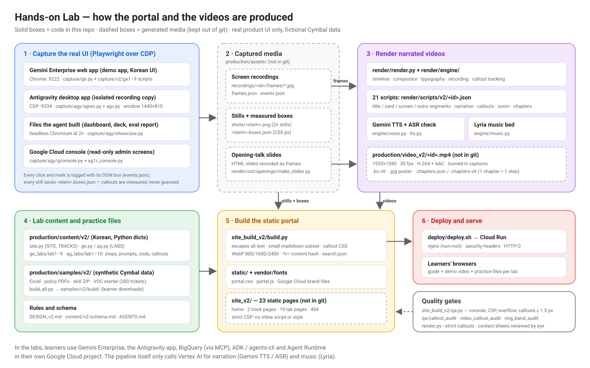
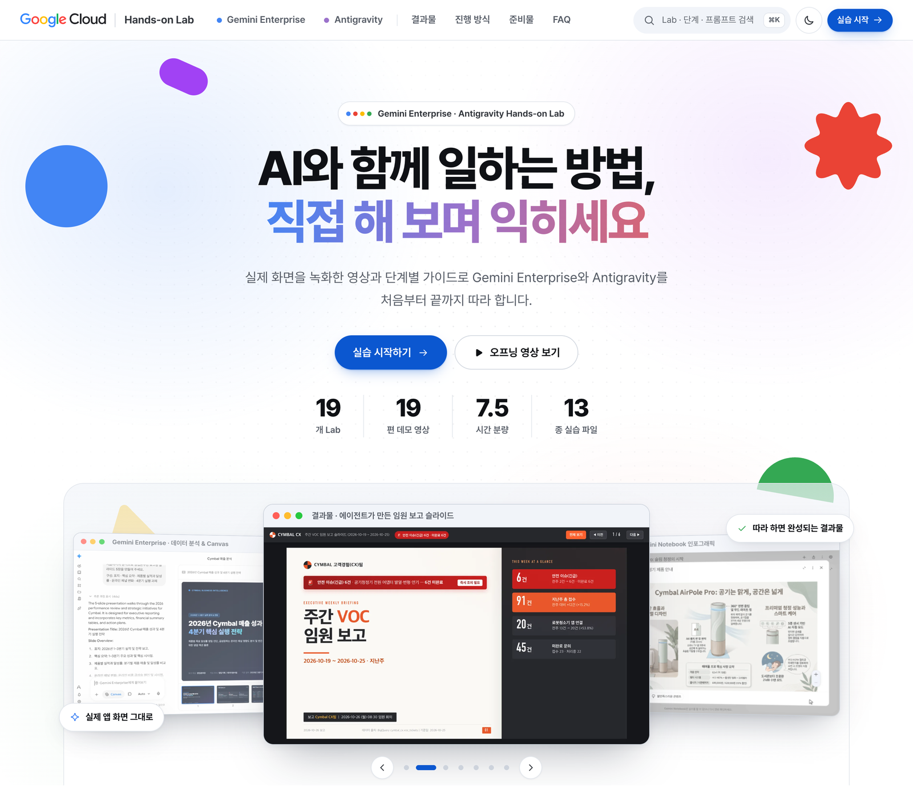
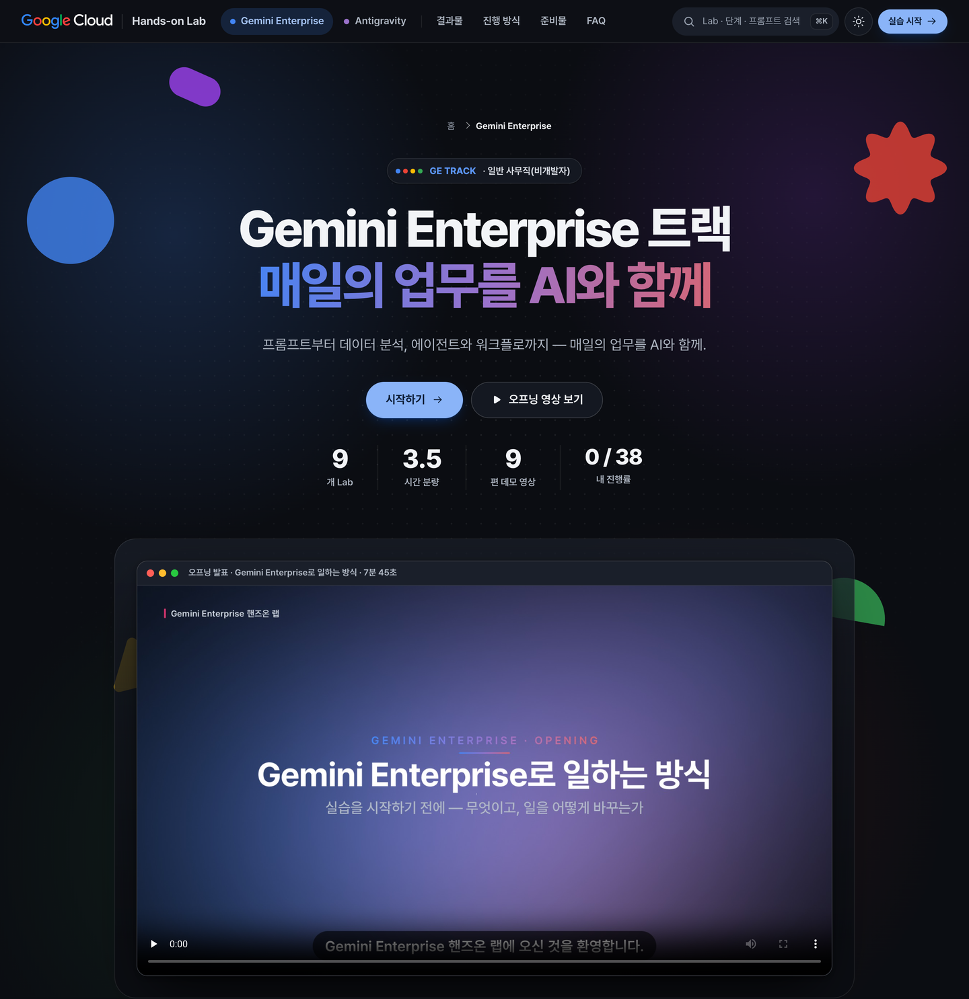
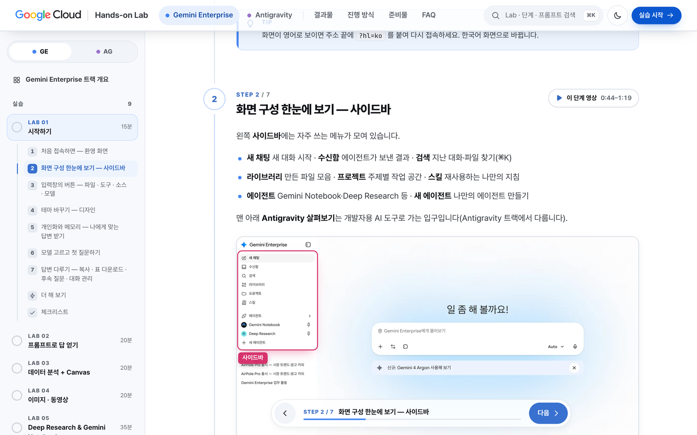
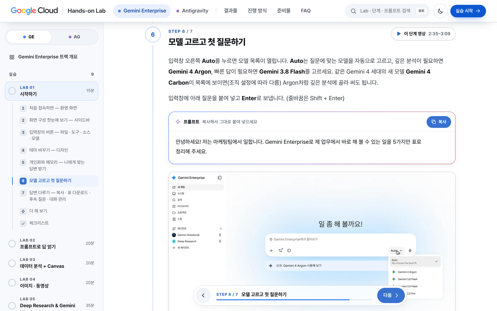

# Gemini Enterprise & Antigravity Hands-on Lab

A complete, reproducible **hands-on training portal** for two Google products — **Gemini Enterprise** (for
everyday office work, no coding) and **Antigravity** (agent-first software development) — together with the
pipeline that produced it: real-UI screen capture, narrated video rendering, a static site builder, automated
quality gates and a Cloud Run deployment.

The source edition is **Korean**. This repository contains everything needed to rebuild it or to produce an
**English (or any other language) edition** — see [docs/LOCALIZATION.md](docs/LOCALIZATION.md). All company names,
people and data are **fictional** (Google's demo brand *Cymbal*).

| | |
|---|---|
| **Tracks** | Gemini Enterprise (9 labs, ~3.5 h) · Antigravity (10 labs, ~4 h, one continuous story) |
| **Per lab** | step-by-step guide · copy-ready prompts and commands · screenshots with measured callouts · a narrated demo video with one chapter per step · checklist · "try more" prompts |
| **Videos** | 21 (2 opening talks + 19 lab demos), ≈ 107 minutes, 1080p, Korean narration and captions |
| **Portal** | 23 static pages (home, 2 track pages, 19 lab pages, 404), strict CSP, dark mode, search, no tracking |
| **Practice files** | synthetic Excel, policy PDFs, a GE skill, and an Antigravity starter project with 300 VOC tickets |
| **Principle** | real product UI only — every screen in the portal and the videos is a recording of the real app |

## Architecture



1. **Capture** — Playwright drives the real apps over the Chrome DevTools Protocol at a fixed 1440×810 viewport:
   the Gemini Enterprise web app, the Antigravity desktop app (an isolated recording instance), headless 2×
   captures of the files the agent built, and read-only Google Cloud console screens. Every click is logged with
   its DOM box, every still saves its boxes — so callouts are *measured*, never guessed.
2. **Render** — JSON scripts describe each video (title, agenda cards, screen segments with zoom, narration,
   callouts, labels, chapters). The engine composites 1080p30 video, narrates with Gemini TTS (each take checked by
   speech recognition), adds a Lyria music bed, burns in captions and writes WebVTT + chapter files.
3. **Build** — a Python static-site builder turns the Korean content modules, stills, videos and practice files
   into a 23-page portal (escaped text, tiny markdown subset, WebP srcsets, content-hashed media URLs,
   build-time callout CSS, no inline script or style).
4. **QA** — real-browser checks (console, CSP, overflow, callout position ≤ 1.5 px on desktop/mobile/lightbox),
   OCR-based callout audits for stills and videos, and a ring-band audit that fails when a video callout ring
   crosses text or the frame edge.
5. **Deploy** — nginx (non-root) on Cloud Run, HTTP/2 end to end, security headers, `no-cache` HTML.

Details: [docs/ARCHITECTURE.md](docs/ARCHITECTURE.md).

## Agenda

| GE | Gemini Enterprise lab | Level · min | | AG | Antigravity lab | Level · min |
|---|---|---|---|---|---|---|
| 0 | Opening: how you work with Gemini Enterprise | talk · 8 | | 0 | Opening: building software with agents | talk · 10 |
| 1 | Getting started | Intro · 15 | | 1 | Getting started A — GE license (admin console + sign-in) | Intro · 15 |
| 2 | Getting answers with prompts | Intro · 20 | | 2 | Getting started B — personal Google account | Intro · 10 |
| 3 | Data analysis + Canvas | Basic · 20 | | 3 | Taking on the project — layout, @mentions, approvals, /plan | Intro · 20 |
| 4 | Images & video (Nano Banana, Veo 3.1) | Basic · 20 | | 4 | Build the VOC dashboard — Proceed, review, /browser | Basic · 30 |
| 5 | Deep Research & Gemini Notebook | Intermediate · 35 | | 5 | Team rules (AGENTS.md) & a weekly-report skill | Basic · 25 |
| 6 | Productivity — skills, projects, library | Intermediate · 20 | | 6 | Company data via MCP — BigQuery | Basic · 25 |
| 7 | Chat agent — internal help desk (sub-agents, schedule) | Advanced · 30 | | 7 | Executive slides from a company template + PDF | Basic · 25 |
| 8 | Workflow — inquiry triage with human approval | Advanced · 35 | | 8 | VOC analysis agent with ADK — agents-cli run & eval | Advanced · 35 |
| 9 | Sharing, gallery & managing agents | Advanced · 15 | | 9 | Deploy to Agent Runtime + publish to Gemini Enterprise | Advanced · 30 |
| | | | | 10 | Operations automation — /schedule + sub-agents | Advanced · 25 |

The Antigravity labs 3–10 follow one story: a developer at Cymbal receives a request from the customer-experience
team (a VOC dashboard, an automated weekly report, and a VOC assistant in Gemini Enterprise) and delivers all of it
in one project folder, from `/plan` to an ADK agent published in Gemini Enterprise and a scheduled weekly job.
Every step, goal and result: [docs/AGENDA.md](docs/AGENDA.md).

## How the videos were made

- **Real recordings only.** Screencast frames + an event log (`click`, `mark`, cut intervals) from the live apps; no
  mock-ups. The Antigravity takes run in a fresh conversation per step on a pinned 1440×810 window.
- **Script-driven rendering.** One JSON script per video (`production/render/scripts/v2/`) with segments, narration
  sentences (`text` for captions, `say` for pronunciation), callouts tied to recorded click boxes, zoom/pan, speed
  ramps and a step→chapter map.
- **Narration that matches the captions.** Gemini TTS with one fixed instructor style; every take is transcribed back
  and regenerated if a word, pause or pace is off. A pronunciation lexicon handles product names.
- **Results first.** Labs that build something open with a short preview of the finished result and end on it.
- **Audited.** Strict callout tracking at render time, per-callout contact sheets reviewed by eye, ring-band audit
  FAIL 0, and OCR leak scans of frames for local paths, accounts and real brand names.

Full guide: [docs/VIDEO_PRODUCTION.md](docs/VIDEO_PRODUCTION.md) · per-video catalog with chapters:
[docs/VIDEOS.md](docs/VIDEOS.md).

## How the UI was designed

Google Cloud look and feel (official logo files only), Google Blue actions with four-colour accents, rounded cards
and pill controls, light and dark themes, a rotating 3D hero deck of real captures, a "results" bento, a learning
path per track, and a lab page built for doing: sticky step navigation and a floating step dock, chapter chips that
jump the video to the current step, copy buttons on every prompt and command, screenshots with measured callouts
and a lightbox, and a checklist that remembers progress locally. Full guide: [docs/UI_DESIGN.md](docs/UI_DESIGN.md).

| Home (light) | GE track page (dark) |
|---|---|
|  |  |

| Lab page: steps, measured callout, step dock | Lab page: prompt card with copy button |
|---|---|
|  |  |

*The portal text is Korean (source edition); all screens shown inside it are real recordings of the products with
fictional Cymbal data.*

## Quick start

```bash
python3 -m pip install -r requirements.txt
python3 -m playwright install chromium

# 1) Build the portal from this repository alone (text, steps, prompts, code, files — no stills/videos yet)
python3 production/site_build_v2/build.py           # → site_v2/ (warns for every missing still / video)
python3 production/serve_site.py site_v2 8080       # preview → http://127.0.0.1:8080 (Ctrl+C to stop)
python3 production/site_build_v2/qa.py              # browser QA (also passes on this text-only build)

# 2) Regenerate the synthetic practice files (optional; they are committed under production/samples/v2/build/)
(cd production/samples/v2 && python3 build_all.py)

# 3) Record, render and check (needs your own Gemini Enterprise app, the Antigravity app and a Google Cloud project)
#    see production/capture/README.md, production/render/README.md and docs/VIDEO_PRODUCTION.md
TTS_PROJECT=your-project-id python3 production/render/render.py production/render/scripts/v2/ge1.json --dry-run

# 4) Deploy
PROJECT=your-project-id deploy/deploy.sh
```

## Repository map

| Path | What it is | README |
|---|---|---|
| `production/content/v2/` | lab content (Korean): site, tracks, 19 lab modules | [content](production/content/README.md) |
| `production/site_build_v2/` | static site builder, browser QA, CSS/JS/brand/fonts | [site_build_v2](production/site_build_v2/README.md) |
| `production/capture/` | real-UI capture: GE web app, Antigravity app, showcase stills, console | [capture](production/capture/README.md) |
| `production/render/` | video engine, 21 render scripts, opening slides, tools | [render](production/render/README.md) |
| `production/qa/` | callout, video-callout and ring-band audits, OCR helpers | [qa](production/qa/README.md) |
| `production/samples/v2/` | synthetic practice-file generators and built downloads | [samples](production/samples/v2/README.md) |
| `deploy/` | Cloud Run + nginx | [deploy](deploy/README.md) |
| `tools/check_sensitive.py` | pre-publish leak scanner | below |
| `AGENTS.md` | rules for AI agents and humans working in this repo | — |
| `production/DESIGN_v2.md` | original design & fact guide (Korean) | — |

## Documentation

| Document | Contents |
|---|---|
| [docs/ARCHITECTURE.md](docs/ARCHITECTURE.md) | stages, data contracts, coordinate system, naming, dependencies, security model, quality gates |
| [docs/AGENDA.md](docs/AGENDA.md) | both tracks lab by lab: goals, steps, results, storyline |
| [docs/VIDEOS.md](docs/VIDEOS.md) | all 21 videos: length, segments, recordings, chapters |
| [docs/VIDEO_PRODUCTION.md](docs/VIDEO_PRODUCTION.md) | capture → render → audit, script format, recipes |
| [docs/UI_DESIGN.md](docs/UI_DESIGN.md) | design system, page anatomy, interactions, callout geometry, accessibility |
| [docs/LOCALIZATION.md](docs/LOCALIZATION.md) | how to produce the English edition |

## Privacy and what is not included

- No recordings, stills, rendered videos or built site are committed — they are generated locally and can show
  the recording environment. The pipeline reads environment identifiers (project, app IDs, accounts) from
  environment variables; no account- or project-specific value is hard-coded.
- Before pushing anything, run the leak scanner and add your own identifiers:

  ```bash
  SENSITIVE_DENYLIST="my-project-id,my-username,customer-name" python3 tools/check_sensitive.py
  ```

  It scans text files, ZIP/XLSX members and PDF text for local paths, e-mail addresses, 12-digit project numbers,
  tokens/keys and your denylist (exit code 1 on findings).

Third-party fonts and Google brand assets: [THIRD_PARTY_NOTICES.md](THIRD_PARTY_NOTICES.md).
