# Agenda — what learners do in each lab

The portal has **two tracks** that can be run independently or back-to-back. Each track opens with a
short talk video, then a sequence of labs. Every lab page follows the same pattern:

> **watch the demo video → copy the prompt / command → do it yourself → tick the checklist**

All lab content in this repository is written in **Korean** (the source edition). English titles below are
translations for orientation; the Korean original is given so you can find the matching file in
`production/content/v2/`. All company names, people and data are **fictional** (the Google demo brand
**Cymbal**, Korean transliteration 심벌).

| Track | Audience | Labs | Planned time | Steps | Checklist items | Demo video (total) |
|---|---|---|---|---|---|---|
| **Gemini Enterprise (GE)** | Office workers, no coding | 9 | 210 min (3 h 30 m) | 57 | 38 | 33 min 23 s + 7 min 46 s opening |
| **Antigravity (AG)** | Developers and tech-savvy business users | 10 | 240 min (4 h) | 53 | 60 | 56 min 35 s + opening |

Level labels used on the pages: 입문 = *Intro*, 기본 = *Basic*, 중급 = *Intermediate*, 심화 = *Advanced*
(`LEVELS` in `production/site_build_v2/build.py`).

Per-video details (length, chapters, recordings used) are in [VIDEOS.md](VIDEOS.md).

---

## Track 1 — Gemini Enterprise (`production/content/v2/ge.py`, `ge_labs/`)

**Tagline:** *From prompts to data analysis, agents and workflows — everyday work with AI.*
(프롬프트부터 데이터 분석, 에이전트와 워크플로까지 — 매일의 업무를 AI와 함께.)

**Opening talk** — *How you work with Gemini Enterprise* (`ge_opening`, 7:46): how work changed
(keyword search → generative answers with sources → agents that plan and use tools), GE as one secure front door
to workplace AI (assistant, Deep Research / Notebook, your own agents and workflows, connectors that keep
existing permissions, admin controls, company data not used for model training), a tour of the real GE home
screen, a one-page feature map, the model picker, what makes a good prompt, clips from Labs 2–3 (prompt,
Excel analysis, chart, Canvas slides), four safety rules (no training on company data, permissions preserved,
answers are drafts to verify against sources, check share-link scope), the lab map, and how to use the portal.

**Practice files** (synthetic, generated by `production/samples/v2/`): monthly sales workbook (Lab 3),
customer-inquiry log (Lab 8), three internal policy PDFs — travel & expenses, leave & work, IT security
(Lab 7), new-product brief "AirPole Pro" (Labs 4, 5, 8), brand guide (Labs 4, 6), report-style skill ZIP
(Lab 6, reused in Lab 9), plus an all-in-one ZIP.

| # | Lab (Korean original) | Level · time | What the learner does | Result shown big |
|---|---|---|---|---|
| 1 | **Getting started** (시작하기) | Intro · 15 min | Welcome screen, sidebar and input-box tour, theme, personalization & memory, model picker, first question, working with answers | First answer with copy / table download |
| 2 | **Getting answers with prompts** (프롬프트로 답 얻기) | Intro · 20 min | Vague vs. good prompt, the 4 elements *role · task · context · format*, web grounding and sources, follow-ups, rename & share | A sourced, well-structured answer |
| 3 | **Data analysis + Canvas** (데이터 분석 + Canvas) | Basic · 20 min | As a sales analyst: upload an Excel file → analysis ideas → quarterly attainment table + hypotheses → online-share line chart → 5-slide report in Canvas (PPTX/PDF export) | Canvas slide deck |
| 4 | **Images & video** (이미지 · 동영상) | Basic · 20 min | As a marketer: upload a product brief → image prompt → key visual with Nano Banana → edit by talking → teaser with Veo 3.1 → pre-publication checks | Key visual + teaser video |
| 5 | **Deep Research & Gemini Notebook** | Intermediate · 35 min | As a strategy planner: Deep Research report (plan → research → report, table, sources, audio summary) → Notebook grounded on the brief PDF → Studio: video overview, audio overview, slides, infographic | Studio outputs (infographic, slides, video & audio overview) |
| 6 | **Productivity — skills, projects, library** (생산성 — 스킬 · 프로젝트 · 라이브러리) | Intermediate · 20 min | Upload a report-style skill ZIP, invoke it with `/cymbal-report-style`, tour library, projects, unified search and agents | Meeting notes reformatted by the skill |
| 7 | **Chat agent — Cymbal internal help desk** (채팅 에이전트 — Cymbal 사내 지원 데스크) | Advanced · 30 min | Build a no-code chat agent from natural language + policy PDF, `@mention` it; then edit node instructions, model, connectors, knowledge, starter prompts; add **two parallel sub-agents** with their own PDF knowledge; scheduled automation; verify a compound question; Update | 3-node multi-agent answering a compound question |
| 8 | **Workflow — inquiry triage & reply drafts** (워크플로 — 고객 문의 자동 분류 · 답변 초안) | Advanced · 35 min | Create a workflow from a description, add a step by chatting, test, enable; then edit trigger (08:30), attach a file to a step, visual JSON-schema editor, flow control (condition / loop / filter), **human-in-the-loop approval** with approved / rejected branch agents, connect an existing ADK agent, full test, Update | Approved run of the daily briefing workflow |
| 9 | **Sharing, gallery & managing agents** (에이전트 공유 · 갤러리 · 관리) | Advanced · 15 min | Agent gallery (Google-made, org-shared, mine), card menu (edit / delete / status), `@mention` from any chat, call a company ADK agent running on Vertex AI Agent Engine, combine its answer with a skill into a one-page report | One-page report from agent + skill |

<b>GE step titles (all 57)</b>

**Lab 1 — Getting started** (7 steps)
1. First visit — the welcome screen
2. The layout at a glance — the sidebar
3. Buttons in the input box — files · tools · sources · model
4. Change the theme — design
5. Personalization and memory — answers tailored to you
6. Pick a model and ask your first question
7. Working with answers — copy · table download · follow-ups · managing chats

**Lab 2 — Prompts** (5)
1. Start with a vague question — what is missing?
2. The four elements of a good prompt — role · task · context · format
3. Check the sources — always verify the evidence
4. Ask follow-up questions — refine the result
5. Tidy up and share — rename · share link

**Lab 3 — Data analysis + Canvas** (4)
1. Upload the Excel file and get analysis ideas
2. Quarterly results and target attainment by product, with hypotheses
3. Chart the online-sales share trend
4. Build a 5-slide report in Canvas and export it

**Lab 4 — Images & video** (5)
1. Upload the brief and get an image prompt first
2. Create the key visual with the image tool
3. Edit by talking — change only the time of day and lighting
4. Make a teaser with the video tool (Veo 3.1)
5. Check before you use it — brand guide and cautions

**Lab 5 — Deep Research & Gemini Notebook** (6)
1. Open Deep Research from the sidebar and request research
2. Review the research plan, then click *Start research*
3. Review the finished report · comparison table · sources · audio summary
4. Upload the brief PDF to Gemini Notebook and ask evidence-based questions
5. Create audio · video · slides · infographic in the Studio at once
6. Open the finished outputs — video overview · audio · slides · infographic

**Lab 6 — Skills, projects, library** (3)
1. Upload the company report-style skill ZIP under *Skills*
2. Press `/` in the chat to invoke the skill and tidy meeting notes
3. Tour the library · projects · unified search · agents

**Lab 7 — Chat agent** (10)
1. *+ New agent* → *Chat agent*; describe it together with the policy PDF
2. Test policy questions in *Preview*, then open the *Flow*
3. Check the agent node details (instructions · model · knowledge), then *Create*
4. Call it from *Chat with agent* and from the normal chat with `@mention`
5. Reopen the agent, add rules to *Instructions* and choose a *Model*
6. Remove the web-search *connector* · upload a *knowledge* PDF · edit *starter prompts*
7. Add the first sub-agent ("settlement-deadline calculator") with the canvas ⊕ button
8. Add the second, parallel sub-agent ("leave, work-policy & security advisor") · *Add connector* dialog · attach its own knowledge PDF
9. Explore scheduled automation for chat agents in the *Schedule* tab
10. Verify a compound question delegated to both sub-agents in *Preview*, then publish with *Update*

**Lab 8 — Workflow** (12)
1. *+ New agent* → *Workflow*; describe the step-by-step flow in natural language
2. Ask for an extra step by chatting; check the trigger and node details
3. Run the basic workflow in the *Test* tab and verify the briefing
4. Check *Enable* and the permission notice
5. Reopen the workflow, check the *trigger* type and change the start time to 08:30
6. Edit the step-1 classification agent node: instructions · connected apps · model
7. Attach the product-brief file to the step-1 node and explore the visual JSON-schema editor
8. Add a flow-control *Condition* node and look at the If / Else expression
9. Add a human-in-the-loop *Approval* node and insert the previous step's briefing as a variable
10. Add a "CS-team announcement summary agent" on the *approved* branch · insert variables · rename
11. Connect an existing ADK agent ("Cymbal event guide") and set up a human-in-the-loop *Request info* node on the *rejected* branch
12. Verify the full run including approval in the *Test* tab, then *Update*

**Lab 9 — Sharing & managing agents** (5)
1. Browse company agents in the sidebar *Agents* gallery
2. Edit · delete · manage status from the agent card menu (⋮)
3. Call any agent instantly with `@AgentName` from any chat
4. `@mention` the company ADK agent running on Vertex AI Agent Engine
5. Combine the agent's answer with the `/cymbal-report-style` skill to finish a one-page report

---

## Track 2 — Antigravity (`production/content/v2/ag.py`, `ag_labs/`)

**Tagline:** *One request from the CX team, delivered in a week — dashboard → company data via MCP →
report automation → a company-wide agent.*
(CX팀의 요청 하나를 일주일 만에 — 대시보드 → MCP로 회사 데이터 연결 → 보고 자동화 → 전사 에이전트까지.)

### The storyline ("cymbal-voc")

Labs 3–10 are one continuous story. The learner is a developer on Cymbal's digital-innovation team. On
Monday morning a request arrives from the CX (customer experience) team lead: automate the weekly
**VOC (voice-of-the-customer)** tally that the team does by hand. The request
(`cymbal-voc/요청서_CX팀.md` in the starter ZIP) has three items:

1. a **VOC dashboard**,
2. **weekly report automation** — a summary every Monday by 08:30, and executive slides,
3. a **VOC assistant** that anyone on the CX team can ask in Gemini Enterprise.

A single project folder, `cymbal-voc` (starter: `Cymbal_VOC_스타터.zip`, built by
`production/samples/v2/build_voc_starter.py` — request memo, 300 synthetic tickets over 4 weeks, `lab.env`,
a BigQuery load script and the executive deck template), grows from Lab 3 to Lab 10:

```mermaid
flowchart LR
  L3["Lab 3: read request, verify numbers, /plan"] --> L4["Lab 4: VOC dashboard"]
  L4 --> L5["Lab 5: AGENTS.md rules + weekly-report skill"]
  L5 --> L6["Lab 6: BigQuery via MCP"]
  L6 --> L7["Lab 7: 6-slide executive deck + PDF"]
  L7 --> L8["Lab 8: ADK VOC agent, run + eval"]
  L8 --> L9["Lab 9: deploy to Agent Runtime + publish to GE"]
  L9 --> L10["Lab 10: /schedule weekly job + sub-agents"]
```

Facts used in narration and checks (ticket counts, the week-over-week jump in safety issues, the six
unresolved safety tickets, …) come from `production/samples/v2/answer_keys/voc_facts.json`.

**Opening talk** — *Building software with agents* (`ag_opening`): how AI-assisted coding evolved
(autocomplete → chat helpers → agents that plan, use files / terminal / browser and verify), the Antigravity
family (desktop app, the `agy` CLI, *Antigravity for IDEs* extensions, the Python SDK), the cymbal-voc story with
a preview of the results (Lab 4 dashboard, Lab 7 deck), the five-step way of working with an agent (request with
goal and constraints → `/plan` writes an Implementation Plan → review, comment, *Proceed* → the agent edits files,
runs commands and checks the browser → review the changes, *Accept* / *Reject*, read the Walkthrough) shown with
real clips, review policies (*Request Review*, *Default* sandbox, *Turbo* only in practice folders; admin policies
for company accounts), team rules (`AGENTS.md`) and skills, MCP with BigQuery, ADK + agents-cli, publishing to GE,
the two sign-in options, the lab map and safe-practice reminders.

| # | Lab (Korean original) | Level · time | What the learner does | Result shown big |
|---|---|---|---|---|
| 1 | **Getting started A — GE license** (시작하기 A — GE 라이선스) | Intro · 15 min | Admin side in the Google Cloud console: supported editions & billing, APIs & IAM roles, *AI developer tools* on, security policies & logs, features (`/boost`, `/teamwork-preview`), allowed models, usage metrics; user signs in with **Use Business Account** | Configured console + signed-in app |
| 2 | **Getting started B — personal Google account** (시작하기 B — 개인 Google 계정) | Intro · 10 min | *Continue with Google*, browser sign-in, plan differences (Free / Google AI Pro / Google AI Ultra: quotas and models), AI-credit overages, differences from a company account | Signed-in app |
| 3 | **Taking on the project — layout & basics** (프로젝트 받기 — 화면 구성과 기본 사용) | Intro · 20 min | Open `cymbal-voc`, read the request; permissions, panels, model; understand request & data with `@mentions`; verify numbers with tools (approve commands); plan the dashboard with **`/plan`** and give feedback | Implementation plan |
| 4 | **Build the VOC dashboard** (VOC 대시보드 만들기) | Basic · 30 min | *Proceed* → review changes (*Accept all*); *Always Proceed* only in the practice folder; verify with **`/browser`** (report + screenshots); add a product filter and "urgent only"; verify again; use the dashboard to answer the CX lead's question | Working dashboard (`index.html`, `styles.css`, `app.js`) |
| 5 | **Team rules & the weekly-report skill** (팀 규칙과 주간 보고 스킬) | Basic · 25 min | Write **`AGENTS.md`** (always-on team rules: masking, date format, …), check & fix against it, build a **skill** (`SKILL.md` + calculation script), confirm automatic skill selection, call it with `/` and see *Customizations* | Weekly VOC report produced by the skill |
| 6 | **Connect company data with MCP — BigQuery** (MCP로 회사 데이터 연결 — BigQuery) | Basic · 25 min | Fill `lab.env`, load data with `setup/load_to_bigquery.sh`; install the **BigQuery MCP server from the MCP Store**; query real data with MCP tools (approval cards show the SQL); find the cause of a spike; upgrade the skill to read BigQuery | Week-over-week table from BigQuery |
| 7 | **Executive report slides** (임원 보고 슬라이드) | Basic · 25 min | Company template (`templates/exec_deck_template.html`) + skill + BigQuery MCP → **6 slides**; check with `/browser`, export PDF; apply the lead's feedback; review the deck in presentation mode and verify numbers | 6-slide 16:9 deck + PDF |
| 8 | **VOC analysis agent — ADK** (VOC 분석 에이전트 — ADK) | Advanced · 35 min | Create an ADK project with **agents-cli**, add two BigQuery tools (weekly summary, urgent tickets), `agents-cli run` (watch tool calls), `agents-cli eval` with 3 cases, open the eval report | Eval report with scores |
| 9 | **Deploy + publish to Gemini Enterprise** (배포 + Gemini Enterprise 게시) | Advanced · 30 min | `agents-cli deploy` to **Agent Runtime**, grant BigQuery IAM roles to the runtime's service agent, `agents-cli publish gemini-enterprise`, ask the agent in GE as a CX team member; commands and cost clean-up | GE answer: 6 unresolved safety tickets, names/phones masked |
| 10 | **Operations automation** (운영 자동화) | Advanced · 25 min | **`/schedule`** the weekly report for Mondays 08:30, check status / next run / Send Now / cancel; run **two sub-agents** in parallel (unit tests + weekly ops guide in README); wrap-up: the three request items, permissions, cost, schedule clean-up | Scheduled job + passing tests + recap montage |

<b>AG step titles (all 53)</b>

**Lab 1 — GE license** (9 steps)
1. Check first — which sign-in method do you use?
2. Admin prep ① — supported editions and billing account
3. Admin prep ② — APIs and IAM roles
4. Admin setting ③ — turn on *AI developer tools*
5. Admin setting ④ — security policies and logs
6. Admin setting ⑤ — features: `/boost` · `/teamwork-preview`
7. Admin setting ⑥ — allowed models
8. User — sign in with *Use Business Account*
9. Admin — usage (*Developer tools metrics*)

**Lab 2 — Personal Google account** (5)
1. Install the app, then *Continue with Google*
2. Sign in in the browser and return to the app
3. Plan differences — quotas and models
4. When the quota runs out — AI credits
5. How is this different from a company account (Lab 1)?

**Lab 3 — Taking on the project** (5)
1. Open the practice folder and read the request
2. Prepare permissions · panels · model
3. Understand the request and data with `@mentions`
4. Verify numbers with tools — approve command execution
5. Plan the dashboard with `/plan` and give feedback

**Lab 4 — VOC dashboard** (6)
1. Build per plan — *Proceed* and review changes
2. Change settings — *Always Proceed* only in the practice folder
3. Check the page with `/browser` — verification report and screenshots
4. Add features — product filter and "urgent only"
5. Verify again — confirm the filters with `/browser`
6. Use the finished dashboard yourself

**Lab 5 — Team rules & skill** (5)
1. Create the team-rules file `AGENTS.md`
2. Check and fix according to the rules
3. Build the weekly-report skill — `SKILL.md` + script
4. Confirm the skill is used automatically — auto-selection
5. Call it directly with slash (`/`) and *Customizations*

**Lab 6 — MCP + BigQuery** (5)
1. Fill the lab variables and load the data into BigQuery
2. Install the BigQuery MCP server from the MCP Store
3. Query real data with MCP tools
4. Find the cause in the data
5. Upgrade the skill to MCP and run it again

**Lab 7 — Executive slides** (4)
1. Build slides from the company template + skill + BigQuery MCP
2. Check with `/browser` and export to PDF
3. Apply feedback — key three lines into one · numbers on the safety issue → PDF again
4. The finished six slides — page through in presentation mode and review the numbers

**Lab 8 — ADK agent** (5)
1. Create an ADK agent project with agents-cli
2. Add two BigQuery tools — weekly summary · urgent tickets
3. Run with `agents-cli run` — check the tool calls
4. Evaluate with `agents-cli eval` — three cases
5. Open the evaluation report and check the scores

**Lab 9 — Deploy + publish** (5)
1. Deploy to Agent Runtime — `agents-cli deploy`
2. Give the deployed agent BigQuery permissions — IAM
3. Publish to Gemini Enterprise — `agents-cli publish gemini-enterprise`
4. Use it in Gemini Enterprise — a CX team member's question
5. Do it yourself with commands · clean up (cost)

**Lab 10 — Operations automation** (4)
1. Schedule the Monday 08:30 report with `/schedule`
2. Check the schedule · ask for status · stop it
3. Two sub-agents for tests and the ops guide at the same time
4. Wrap-up — the three request items and what to watch in operations

---

## Suggested delivery formats

These are suggestions derived from the planned times above, not part of the code.

| Format | Content |
|---|---|
| Half day, business users | GE opening + GE Labs 1–6 (≈ 2 h 10 m hands-on) |
| Half day, builders | GE Labs 7–9 (no-code agents & workflows) + AG opening + AG Labs 1/2–3 |
| Full day, developers | AG opening + AG Labs 1/2 → 10 (≈ 4 h hands-on; Labs 6–10 need a Google Cloud project with BigQuery and, for 8–9, `gcloud`, `agents-cli` and ADC) |
