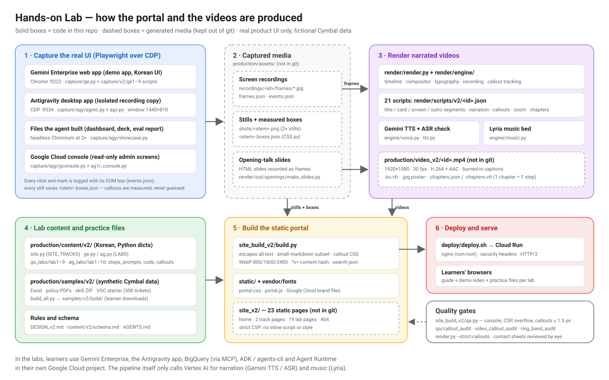

# Architecture

This repository is a small, file-based production system that turns **real product recordings** and
**structured lab content** into a static training portal with narrated videos. There is no database and no
server-side code: Python scripts produce files, a static site builder assembles them, and nginx serves the
result.



## 1. Stages at a glance

| # | Stage | Code | Input | Output (location) | In git? |
|---|---|---|---|---|---|
| 1 | **Capture** real UI over the Chrome DevTools Protocol | `production/capture/` | a running browser / desktop app you are signed in to | screen recordings `production/assets/recordings/<id>/`, stills `production/assets/shots/<stem>.png` (+ `.boxes.json`) | no (media) |
| 2 | **Opening slides** (HTML) recorded as frames | `production/render/out/openings/make_slides.py` | slide HTML generated in the script | `production/render/out/openings/recs/<slide_id>/` | no (media) |
| 3 | **Render** narrated videos | `production/render/render.py`, `production/render/engine/` | render scripts `production/render/scripts/v2/<id>.json` + recordings | `<id>.mp4`, `.ko.vtt`, `.jpg`, `.chapters.json`, `.chapters.vtt` (kept in `production/video_v2/`) | scripts yes, media no |
| 4 | **Author** lab content | `production/content/v2/` | — (hand-written Korean text, prompts, commands, callout boxes) | Python modules | yes |
| 5 | **Generate** practice files | `production/samples/v2/` | generators + fixed seeds | `production/samples/v2/build/` (xlsx, pdf, zip, previews) | yes |
| 6 | **Build** the portal | `production/site_build_v2/build.py` | content + stills + videos + practice files + `static/` + vendored fonts | `site_v2/` (23 pages + assets) | no (build output) |
| 7 | **QA** | `production/site_build_v2/qa.py`, `production/qa/`, `render.py --strict-callouts` | built site, stills, renders | reports, contact sheets in `production/qa/out/` | no |
| 8 | **Deploy** | `deploy/` | `site_v2/` | Cloud Run service (nginx container) | yes |

Detailed guides: [VIDEO_PRODUCTION.md](VIDEO_PRODUCTION.md) (stages 1–3, 7), [UI_DESIGN.md](UI_DESIGN.md)
(stage 6), [../production/content/README.md](../production/content/README.md) (stage 4),
[../production/samples/v2/README.md](../production/samples/v2/README.md) (stage 5),
[../deploy/README.md](../deploy/README.md) (stage 8).

## 2. Repository layout

```text
.
├── README.md                 project overview (start here)
├── AGENTS.md                 working rules for AI coding agents (and humans) in this repo
├── docs/                     architecture, agenda, video catalog, video production, UI design, localization
├── deploy/                   Dockerfile, nginx config + security headers, deploy.sh, smoke_test.py
├── tools/check_sensitive.py  pre-publish leak scanner (paths, e-mails, project numbers, tokens, your denylist)
└── production/
    ├── DESIGN_v2.md          design & fact guide of the Korean edition (Korean, single source of truth)
    ├── serve_site.py         local preview server with HTTP Range support (video seeking)
    ├── content/v2/           lab content: site.py, ge.py, ag.py, ge_labs/lab1–9.py, ag_labs/lab1–10.py, schema.md
    ├── site_build_v2/        build.py (static site builder), qa.py (browser QA), static/ (css, js, brand, fonts), vendor/fonts (Pretendard)
    ├── capture/              ge.py (GE driver), helpers.py, v2/ge*.py (GE lab recordings), agy/ (Antigravity + console + showcase)
    ├── render/               render.py, engine/, scripts/v2/*.json, tools/, lexicon.json, fonts/ (Pretendard OTF), out/openings/make_slides.py
    ├── qa/                   callout_audit.py, find_text.py + vision_ocr.js (OCR), proof.py, video_callout_audit.py, ring_band_audit.py
    └── samples/v2/           practice-file generators, answer keys, deck template, built downloads (build/)
```

Folders that the scripts create but which are **not** committed (see `.gitignore`): `production/assets/`
(recordings and stills), `production/video_v2/`, `production/render/cache/`, `production/render/out/*` (except
`make_slides.py`), `production/qa/out/`, `site_v2/`, `deploy/.build/`.

## 3. Coordinate system and naming

Everything visual shares one coordinate system so that boxes measured at capture time line up in stills, in
the portal and in the videos:

- Browser viewport and desktop-app window are fixed at **1440 × 810 CSS px** (`VIEW_W, VIEW_H` in
  `production/capture/ge.py`; the Antigravity window is launched at that size by
  `production/capture/agy/launch_ag_rec_voc.sh`).
- **Stills** are captured at device-pixel-ratio 2 → 2880 × 1620 px. The builder infers CSS size from the image
  width (≥ 2400 px ⇒ DPR 2) unless a shot sets `"viewport": [w, h]` (`production/content/v2/schema.md` §3).
- **Screencast frames** are JPEGs of 1440 × 810 or 1920 × 1080 (CDP screencast, capped at 1920 × 1080) with
  timestamps in `frames.json`; showcase recordings are 2880 × 1620 screenshots. The renderer converts CSS boxes with
  `css_scale = frame width / 1440` (`production/render/engine/recording.py`).
- **Boxes** are always `[x, y, w, h]` in CSS px: `events.json` (every `click` / `mark` with the element box),
  `<stem>.boxes.json` (`{"viewport", "targets": {label: box}, "leaves": [...]}` — named targets plus every
  visible text leaf, written by `agrec.py`, `gconsole.py`, `showcase.py`, `ge_voc_agent.py`), lab `callouts`, and render-script
  `box_css`.

Naming conventions (used across content, scripts and media):

| Thing | Pattern | Examples |
|---|---|---|
| GE recording | `ge<lab><letter>_<slug>` | `ge3a_upload`, `ge7h2_subagent2` |
| AG recording | `ag<lab>v_<slug>` (cymbal-voc story), `ag1r_console`, `ag2a_signin` | `ag4v_build`, `ag10v_schedule` |
| Opening slide recording | `ge_s_<slug>`, `ag_s_<slug>` | `ge_s_safety`, `ag_s_loop` |
| GE still | `ge_<lab>_<nn>_<slug>` | `ge_3_32_canvas_ready` |
| AG still | `ag_<lab>v_<nn>[letter]_<slug>` | `ag_7v_21_deck_s1`, `ag_9v_07c_ge_answer` |
| Video id | `ge<lab>`, `ag<lab>`, `ge_opening`, `ag_opening` | `ag7` |

## 4. Data contracts between stages

| Contract | Producer → consumer | Format |
|---|---|---|
| Recording | capture → render | `recordings/<id>/frames/*.jpg`, `frames.json` (frame file + timestamp), `events.json` (list of `{t, wall, kind, label, box, …}`) |
| Still + boxes | capture → content / builder / QA | `shots/<stem>.png` (2×), optional `<stem>.boxes.json` |
| Lab content | author → builder | `LAB` dict per lab (`id, no, title, subtitle, level, minutes, goal, video, steps[], check[], more[]`); each step may have `body`, `prompt`, `code`, `shot(s)` with `callouts`, `tip`, `note` — see [content README](../production/content/README.md) |
| Render script | author → renderer | JSON with `id, track, lab, title, brand, bgm, captions, encode, chapters, segments[]` — see [VIDEO_PRODUCTION.md](VIDEO_PRODUCTION.md) |
| Video bundle | renderer → builder | `<id>.mp4` (+ `.ko.vtt`, `.jpg`, `.chapters.json` `{video, duration, chapters:[{step, title, start, end}]}`, `.chapters.vtt`) |
| Practice files | samples → builder | files under `SITE["files_src"]` (`production/samples/v2/build`), listed per track in `TRACKS[i]["files"]` |

The builder copies or links only what the content references. When a still or a video is missing it prints a
warning and leaves that figure/video out, so the whole site can be built **from this repository alone** (text,
steps, prompts, code, checklists — 23 pages, 0 screenshots) before any recording exists.

## 5. Runtime dependencies

| Need | Used by |
|---|---|
| Python 3.10+ with `playwright`, `Pillow`, `numpy`, `openpyxl`, `pypdf` (see `requirements.txt`) | everything |
| Playwright Chromium (`python3 -m playwright install chromium`) and Google Chrome | capture, showcase stills, sample PDFs, site QA, smoke test |
| `ffmpeg` / `ffprobe` | renderer, video audits |
| macOS (Apple Vision OCR through `osascript -l JavaScript`) | `production/qa/find_text.py`, OCR checks in the video audits |
| A Google Cloud project with Vertex AI enabled (`TTS_PROJECT` or `GOOGLE_CLOUD_PROJECT`, ADC credentials) | narration (Gemini TTS + ASR check) and music (Lyria) |
| A Gemini Enterprise app, the Antigravity desktop app, and a Google Cloud project for BigQuery / Agent Runtime | recording the labs (and doing them) |
| `gcloud` | `deploy/deploy.sh` |

## 6. Security and privacy model

- **Static and read-only.** nginx allows only `GET`/`HEAD`, serves practice files as downloads, hides dotfiles,
  and adds security headers (`deploy/nginx/`). HTML is `no-cache`; CSS/JS/media URLs carry a content hash
  (`?v=`), so a redeploy never shows stale media.
- **Strict CSP** (`CSP` in `production/site_build_v2/build.py`): `script-src 'self'; style-src 'self'`, no inline
  scripts, styles or event handlers. Per-image callout geometry is emitted as generated CSS classes; client JS
  never uses `innerHTML`.
- **Escaping by construction.** Every content string is HTML-escaped; only a tiny markdown subset is
  interpreted; links must be `https://`.
- **No real data.** All practice data is synthetic and labelled as such. Recording hygiene rules (no local
  paths, account names, real company names, unreleased UI) are enforced by brand/path scans in the capture
  scripts and by OCR scans of rendered frames.
- **Pre-publish scan.** `python3 tools/check_sensitive.py` scans every text file, ZIP/XLSX member and PDF text
  for local paths, e-mail addresses, 12-digit project numbers and tokens; add your own identifiers with
  `SENSITIVE_DENYLIST="my-project,my-user"`.

## 7. Quality gates

A lab is "done" only when all of these pass (the rules are in [../AGENTS.md](../AGENTS.md)):

1. `python3 production/site_build_v2/build.py` — 0 warnings (out-of-range callout boxes or invalid `pos` fail
   the build; chapter count ≠ step count warns).
2. `python3 production/site_build_v2/qa.py` (or `--callouts-only`) — real-browser checks on desktop, mobile
   and lightbox: callout box position error ≤ 1.5 px, no clipped label chips, no console/CSP errors, no failed
   requests, no horizontal overflow.
3. `python3 production/qa/callout_audit.py --track <ge|ag> --labs <labN>` — every contact sheet reviewed by eye.
4. `python3 production/render/render.py <script> --strict-callouts`, then
   `TTS_REUSE=1 python3 production/qa/video_callout_audit.py <script>` (review every sheet) and
   `python3 production/qa/ring_band_audit.py <script>` — **FAIL 0**.
5. Video chapters = lab steps; the finished artifact is shown large on the page and in the video.

## 8. What is deliberately not in this repository

- Recordings, stills, rendered videos and the built site (≈ several GB; they also show the recording
  environment). Re-create them with the capture and render scripts against your own apps and project.
- The previous customer-specific edition, its archive and a development fixture that was derived from it.
- Exploratory/one-off capture scripts that were not used for the published labs.
- Any environment identifiers: project IDs and numbers, app IDs, accounts, the deployed URL. These are read
  from environment variables (e.g. `GE_APP_CID`, `LAB_PROJECT_ID`, `TTS_PROJECT`, `PROJECT`) — see the
  READMEs of each folder.
