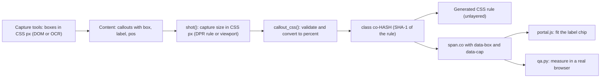

# How the portal UI was designed

The Hands-on Lab portal is a static, multi-page website: 23 HTML pages (home, two track pages, 19 lab pages and a
404 page) generated by [`production/site_build_v2/build.py`](../production/site_build_v2/build.py) from Python
content modules in [`production/content/v2/`](../production/content/v2/). This document explains the design goals,
the design system, the anatomy of every page type, the client-side behaviour, the screenshot-callout pipeline,
media handling, the security model and accessibility — all as implemented in the code. Paths are relative to the
repository root; function names refer to `build.py` unless another file is named.

The UI strings of the source edition are Korean (the screenshots below show that edition). Where strings and
locale-specific behaviour live is summarised in [§ 15](#15-locale-specific-behaviour) and in
[LOCALIZATION.md](LOCALIZATION.md). How to run the builder and the browser QA is described in
[`production/site_build_v2/README.md`](../production/site_build_v2/README.md).


*Home page hero (light theme, 1440 px wide viewport). The deck rotates real captures of finished deliverables.*

## Contents

1. [Goals and audiences](#1-goals-and-audiences)
2. [Design principles](#2-design-principles)
3. [Brand rules](#3-brand-rules)
4. [Design system](#4-design-system)
5. [Light and dark themes](#5-light-and-dark-themes)
6. [Motion and reduced motion](#6-motion-and-reduced-motion)
7. [Responsive behaviour](#7-responsive-behaviour)
8. [Page anatomy](#8-page-anatomy)
9. [Client-side behaviour](#9-client-side-behaviour)
10. [Screenshot callouts](#10-screenshot-callouts)
11. [Media handling](#11-media-handling)
12. [Security model](#12-security-model)
13. [Caching and the preview server](#13-caching-and-the-preview-server)
14. [Accessibility](#14-accessibility)
15. [Locale-specific behaviour](#15-locale-specific-behaviour)
16. [Maintenance notes](#16-maintenance-notes)

---

## 1. Goals and audiences

| Audience | Track | What the UI has to do for them |
|---|---|---|
| Office workers who do not write code | Gemini Enterprise (GE), 9 labs | Show exactly where to click (real screenshots with highlight boxes), give prompts to copy, keep jargon low |
| Developers and technically minded business users | Antigravity (AG), 10 labs | The same, plus terminal commands and file contents in readable code blocks with copy buttons |
| Facilitators of a classroom session | both | One URL, the same structure for every lab, an FAQ per track (the FAQ lead text tells learners to ask the facilitator) |

The audiences come from `TRACKS[].audience` in [`production/content/v2/site.py`](../production/content/v2/site.py)
and from § 0 of [`production/DESIGN_v2.md`](../production/DESIGN_v2.md), which also asks that AG Labs 1–3 stay
doable for non-developers.

Goals that shaped the UI:

- **One rhythm for every lab:** watch the demo video → follow the steps → tick the checklist. The home page states
  it in its "How it works" section (`home_page()`), the track page repeats it in the learning-path lead
  (`track_page()`), and every lab page is laid out in that order (`lab_page()`).
- **Real product UI and big results.** Every product image is a real capture; finished deliverables are shown
  large on the home page (hero deck, "What you'll build" bento) and inside the labs.
- **Pick up where you left off, without accounts.** Checklist ticks and the last opened lab are kept in the
  browser (`localStorage`); "start" buttons turn into "continue" or "review" ([§ 9](#9-client-side-behaviour)).
- **Classroom-friendly hosting.** A static, read-only site behind nginx with content-hashed asset URLs
  ([§ 12](#12-security-model), [§ 13](#13-caching-and-the-preview-server)).

## 2. Design principles

| Principle | How the code enforces it |
|---|---|
| Real screens only | Screenshots are captures referenced by stem (`shot()`); decorative art is abstract SVG (`SHAPES`, `shapes_html()` — "never product logos"); the icon sprite holds generic glyphs only (`static/icons.svg`); the footer note states that images are real captures and that the data is fictional (`SITE["footer_note"]`). |
| One look on every page | The same `topbar()` and `footer()` on all pages; the track page reuses the home hero (`track_page()` docstring); the lab header card uses the same shapes, background and kicker chip. |
| Brand blue everywhere, track colour only as an identity marker | `accent_css()` puts the brand accent on `:root`; a track's own accent only applies inside `.t-<id>` (dots, kickers, home track cards). |
| Measure, never eyeball | Callout boxes are capture-time CSS pixels converted to percentages at build time; the build fails on boxes outside the capture, and `qa.py` fails when a rendered box is more than 1.5 px off ([§ 10](#10-screenshot-callouts)). |
| Progressive enhancement | Every page starts with `class="no-js"`. Without JavaScript all tab panels are shown in sequence, the hero deck is a static three-card fan, the step dock stays hidden, and links, `<details>` and `<video>` keep working. |
| Secure by construction | Strict CSP, no inline script/style/handlers, every string HTML-escaped, a tiny markdown subset, no HTML-string sinks in JavaScript ([§ 12](#12-security-model)). |
| Accessible by default | Accent colours computed against WCAG contrast targets, reduced-motion support, keyboard support for every widget, live-region announcements ([§ 14](#14-accessibility)). |

## 3. Brand rules

- **Logo lockup.** `brand()` renders the official Google Cloud logo, a 1 px separator and the portal title
  (`SITE["title"]`, "Hands-on Lab"). Two `` elements are emitted: `google-cloud.svg` (`.logo-l`) and
  `google-cloud-dark.svg` (`.logo-d`, the reversed logo with a white "Cloud" wordmark). CSS shows the right one for
  the light theme, the pinned dark theme, the system dark preference and inside `.scope-dark` (the footer). At
  ≤ 520 px only the logo is shown.
- **Source of the marks.** [`static/brand/SOURCE.md`](../production/site_build_v2/static/brand/SOURCE.md): the logo,
  `favicon.ico` (16/32 px) and `cloud-192.png` (apple-touch icon) were downloaded unmodified from Google's CDN; the
  dark logo differs only in the wordmark fill. "Do not redraw, recolor (other than the reversed wordmark), stretch or
  add effects to these marks." `copy_brand()` copies them to `assets/img/brand/`, and the build fails if one is
  missing.
- **Colours.** Calls to action use Google Blue (`--brand` `#0B57D0`, `#8AB4F8` in the dark theme); decoration uses
  the Google four colours (`#4285F4`, `#EA4335`, `#FBBC04`, `#34A853`) plus purple `#A142F4`
  ([§ 4.2](#42-colour-tokens)).
- **Shapes, not logos.** The hero shapes are a circle, a rounded triangle, an eight-lobed "cookie"
  (`_flower_path()`), a half circle, a pill and four dots — Material 3 Expressive-style decoration, always
  `aria-hidden`.
- **Fictional company.** All sample data belongs to the fictional company Cymbal and is labelled as fictional in the
  footer note and in the practice-file titles.
- **Trademark line.** The footer always shows a trademark notice for Google, Google Cloud, Gemini and Antigravity
  and states that the portal was made for education (`footer()`).

## 4. Design system

### 4.1 Stylesheet architecture

[`static/css/portal.css`](../production/site_build_v2/static/css/portal.css) declares its cascade layers up front:

```css
@layer reset, tokens, base, layout, components, pages, motion, utilities;
```

`write_static()` assembles the shipped `assets/css/portal.css` from three parts:

1. the Pretendard `@font-face` rules from `vendor/fonts/pretendard.css` (URLs rewritten to `../fonts/pretendard/`),
2. `portal.css` after `dark_wrap()` has replaced the `/*@DARK_TOKENS@*/` placeholder with the dark tokens
   ([§ 5](#5-light-and-dark-themes)),
3. generated rules, **unlayered so they win over every layer**: per-track accent tokens, `.ar-<w>x<h>` aspect
   ratios and the matching lightbox widths, `.op-<x>-<y>` / `.zm-<n>` object-position and zoom classes for the
   bento, and `.co-<hash>` callout geometry.

Class names that JavaScript or QA rely on (`.fig-stage`, `.co`, `.steps > .step`, `.nav-step`, `.chapter`,
`[data-checks]` …) are kept stable on purpose (header comment of `portal.css`).

### 4.2 Colour tokens

Defined in `@layer tokens` of `portal.css` (light) and in
[`static/css/tokens-dark.css`](../production/site_build_v2/static/css/tokens-dark.css) (dark).

| Token | Light | Dark | Used for |
|---|---|---|---|
| `--bg` | `#FFFFFF` | `#0B0D12` | page background |
| `--bg-soft` | `#F7F9FC` | `#0F1218` | alternating sections, sidebar, "try more" panel |
| `--surface` / `--surface-2` / `--surface-3` | `#FFFFFF` / `#F1F4F9` / `#E6EBF2` | `#141821` / `#1A1F2A` / `#242A37` | cards, hover states, bar tracks |
| `--ink` / `--ink-2` | `#0F1115` / `#33373D` | `#F2F4F7` / `#D6DAE1` | headings / body text |
| `--sub` / `--muted` | `#575D67` / `#60666F` | `#AEB6C2` / `#9AA3B1` | secondary / tertiary text |
| `--line` / `--line-2` / `--line-strong` | `#E2E6EC` / `#EDF0F4` / `#CDD3DC` | white at 9 % / 6 % / 17 % | borders and dividers |
| `--brand` / `--brand-hover` / `--on-brand` | `#0B57D0` / `#0842A0` / `#FFFFFF` | `#8AB4F8` / `#AECBFA` / `#0A1A33` | primary buttons |
| `--brand-soft` / `--brand-ink` / `--brand-line` | `#E8F0FE` / `#174EA6` / `#C2D7FB` | `#15233B` / `#A8C7FA` / `#2A4572` | current top-nav item, deck dots, reference cards |
| `--tip-bg` / `--tip-line` / `--tip-ink` | `#EEF4FE` / `#C8DBFB` / `#1558C0` | `#122239` / `#21406D` / `#A8C7FA` | TIP boxes |
| `--note-bg` / `--note-line` / `--note-ink` | `#FFF6E5` / `#F3DCA6` / `#8A4B00` | `#271F10` / `#4C3A17` / `#F6D58E` | note boxes, audio-fallback notice |
| `--lv1` · `--lv2` · `--lv3` (+ `-bg`, `-line`) | `#137333` · `#1558C0` · `#A0337E` | `#8CD9A4` · `#A8C7FA` · `#F2B1D4` | level chips |
| `--ok` / `--ok-solid` | `#188038` / `#188038` | `#6DD58C` / `#1E8E3E` | completion states, ticked boxes, "copied" |
| `--hl` / `--hl-ring` | `#D6336C` / `#FFFFFF` | (same) | screenshot callout boxes and label chips |
| `--glass` | white at 78 % | `rgba(13,16,22,.74)` | top bar, mobile lab bar, step dock (with `backdrop-filter`) |
| `--hero-a` … `--hero-d`, `--dots` | blue / purple / red / green tints | stronger tints | hero background glows and dot grid |
| `--shape-o` | `1` | `.78` | opacity of the decorative shapes |
| `--code-bg` / `--code-head` / `--code-ink` / `--code-sub` | `#0E1117` / `#161B23` / `#E6EDF3` / `#8B949E` | (same) | code blocks are dark in both themes |
| `--g-blue` · `--g-red` · `--g-yellow` · `--g-green` · `--g-purple` | `#4285F4` · `#EA4335` · `#FBBC04` · `#34A853` · `#A142F4` | (same) | Google four-colour accents |
| `--grad` | `linear-gradient(100deg, #4285F4 0%, #9B72CB 52%, #D96570 100%)` | (same) | gradient title lines, prompt-card border, reading progress |
| `--grad-google` | four hard colour stops | (same) | the short bar in front of every eyebrow |

Shadows: `--shadow-xs`, `--shadow-sm`, `--shadow` and `--shadow-lg` (soft slate shadows in light, deeper black
shadows in dark).

### 4.3 Generated accent tokens

`accent_tokens()` turns one accent colour into a set of custom properties and enforces contrast with the WCAG
formula (`contrast()`; `_until()` moves the colour toward black or white in 1 % steps until the target is met):

| Property | Rule | Brand `#4285F4` (light / dark) | AG `#9B72CB` (light / dark) |
|---|---|---|---|
| `--accent` | the colour itself | `#4285F4` | `#9B72CB` |
| `--accent-ink` | text colour, ≥ 4.8 : 1 on `--accent-soft` | `#3469C1` / `#5C96F6` | `#7E5CA4` / `#AA87D3` |
| `--accent-soft` | 9 % tint on white / 17 % tint on `#141821` | `#EEF4FE` / `#1C2B45` | `#F6F2FA` / `#2B273E` |
| `--accent-line` | 30 % / 42 % tint | `#C6DAFC` / `#27467A` | `#E1D5EF` / `#4D3E68` |
| `--accent-solid` | fill that carries white text at ≥ 4.7 : 1 | `#3871CF` | `#8763B1` |
| `--accent-solid-hover` | solid mixed 14 % toward black | `#3061B2` | `#745598` |

`accent_css()` emits the brand set (`BRAND_ACCENT`, `#4285F4`) on `:root` and one set per track on `.t-<id>`
(`TRACKS[].accent`; GE `#4285F4`, AG `#9B72CB`; an invalid hex value silently falls back to `DEFAULT_ACCENT`), each
with dark variants for the system preference and for the pinned dark theme. The values in the table were read from
a build of this repository.

### 4.4 Typography

| Role | Font | Where it comes from |
|---|---|---|
| Korean and general text | Pretendard Variable (weights 45–920) | Vendored in [`production/site_build_v2/vendor/fonts/`](../production/site_build_v2/vendor/fonts/): `pretendard.css` with 92 `@font-face` rules, each limited by a `unicode-range`, and `pretendard/PretendardVariable.subset.0–91.woff2` (SIL Open Font License 1.1, `LICENSE.txt`). Browsers download only the subsets a page needs. |
| Numbers, kickers, timecodes | Inter (variable 100–900, Latin subset) | `static/fonts/inter-latin-wght-normal.woff2` + `LICENSE-Inter.txt` |
| Code | JetBrains Mono (variable 100–800, Latin subset) | `static/fonts/jetbrains-mono-latin-wght-normal.woff2` + `LICENSE-JetBrainsMono.txt` |

`ensure_fonts()` copies the fonts into `assets/fonts/`. It looks for Pretendard in `vendor/fonts/` first and then in
a legacy `site/assets/fonts/` directory that is not part of this repository; if neither exists it warns and the
stacks fall back to system fonts. All faces use `font-display: swap`.

Font stacks (`portal.css`):

```css
--font-sans: "Pretendard", "Apple SD Gothic Neo", "Malgun Gothic", system-ui, -apple-system, "Segoe UI", sans-serif;
--font-num:  "Inter", "Pretendard", system-ui, sans-serif;
--font-mono: "JetBrains Mono", ui-monospace, "SF Mono", SFMono-Regular, Menlo, Consolas, "Pretendard", monospace;
```

Body text is 1 rem with line height 1.65 in `--ink-2`, with `word-break: keep-all; overflow-wrap: anywhere` (Korean
words are not broken mid-word). Headings use weight 750, line height 1.3, letter spacing −0.025 em and
`text-wrap: balance`; paragraphs and list items use `text-wrap: pretty`. Numbers use Inter with `tabular-nums`.

| Element | Size | Weight / tracking |
|---|---|---|
| `.hero-title` | `clamp(2.375rem, 1.4rem + 4.2vw, 4.75rem)`, line height 1.1 | 800 / −0.045 em; the last line uses the gradient (`.grad-text`) |
| `.lab-title` | `clamp(2rem, 1.35rem + 2.6vw, 3.25rem)` | 800 / −0.045 em |
| `.section-title` | `clamp(1.875rem, 1.3rem + 2vw, 2.875rem)` | 800 / −0.035 em |
| `.step-title` | `clamp(1.25rem, 1.08rem + .6vw, 1.5625rem)` | 800 / −0.03 em |
| `.hero-sub` | `clamp(1.0625rem, .98rem + .4vw, 1.3125rem)`, line height 1.75 | — |
| `.prose` (step bodies) | 1.0625 rem, line height 1.85 | — |
| `.eyebrow` | .8125 rem, uppercase, tracking .12 em | 750, preceded by a 22 × 3 px four-colour bar |

Markdown `*emphasis*` is rendered as a yellow highlighter (`font-style: normal` plus a gradient underlay) instead of
italics; `**bold**` uses weight 700 in `--ink`.

### 4.5 Shape, spacing, elevation and layout tokens

| Token | Value | Notes |
|---|---|---|
| `--r-xs` · `--r-sm` · `--r` · `--r-lg` · `--r-xl` | 8 · 12 · 18 · 24 · 32 px | cards 18–32 px; buttons, chips, tabs and the dock are pills (`999px`) |
| `--topbar-h` | 64 px | sticky top bar |
| `--mbar-h` | 0, or 50 px on lab pages below 1024 px | mobile lab bar; part of `scroll-padding-top` |
| `--side-w` | 300 px | lab sidebar |
| `--doc-w` | 860 px (900 px from 1440 px) | lab article width |
| `--wrap` | 1240 px | `.container` max width; inline padding `clamp(18px, 4vw, 40px)` |
| section padding | `clamp(64px, 8vw, 120px)`; tight `clamp(48px, 6vw, 88px)` | `.section`, `.section-tight` |
| `--ease` · `--ease-out` | `cubic-bezier(.2,.7,.2,1)` · `cubic-bezier(.16,1,.3,1)` | the deck uses `cubic-bezier(.65,0,.25,1)` |

Elevation is expressed only through the four shadow tokens. Glass surfaces (`--glass` +
`backdrop-filter: saturate(1.8) blur(16–18px)`) are used for the top bar, the mobile lab bar and the step dock.
Anchor targets land below the sticky bars thanks to
`scroll-padding-top: calc(var(--topbar-h) + var(--mbar-h) + 20px)`.

### 4.6 Components

| Component | Emitted by | Classes / hooks | Design notes |
|---|---|---|---|
| Top bar | `topbar()` | `.topbar`, `.brand`, `.topnav`, `.search-btn[data-cmdk]`, `[data-theme-toggle]`, `.topbar-cta`, `.read-progress` | Sticky glass bar that gains a shadow once stuck (`@container topbar scroll-state(stuck: top)`). Lab pages add a reading-progress line driven by `animation-timeline: scroll(root block)` where supported. |
| Buttons | many | `.btn` + `.btn-primary` / `.btn-secondary`, `.btn-sm` / `.btn-lg` | Pills, min height 44 px (36 px small, 54 px large); the arrow icon nudges 3 px on hover. |
| Chips, pills, dots | `level_chip()`, lab meta | `.chip`, `.chip-level.lv1–3`, `.chip-soon`, `.pill`, `.dot`, `.gdots` | `.dot` is the accent dot with a 3 px halo; `.gdots` are the four Google dots. |
| Progress marks | `state_mark()`, `checklist_html()`, `nav_tree()` | `.ring`, `.state`, `.bar` / `.bar-fill` | Driven by the registered custom property `--p` (`@property --p`, 0‥1) that `portal.js` sets; a ring turns into a green check badge on `.is-complete`. |
| Section head | `section_head()` | `.eyebrow`, `.section-title`, `.section-lead`, `.is-center` | English eyebrow over a Korean title in the source edition. |
| Breadcrumbs | `crumbs()` | `nav.crumbs` | Chevrons drawn with CSS borders; the current item has `aria-current="page"`. |
| Prose and lists | `md_blocks()` | `.prose`, `.md-ul`, `.md-ol` / `.md-n` | List numbers are real DOM text (`.md-n`), never CSS counters. |
| Prompt card | `prompt_block()` | `.prompt`, `.prompt-head`, `.prompt-text`, `.copy-btn` | 1.5 px gradient hairline (`padding-box` / `border-box` backgrounds), sparkle label, "copy and paste as is" hint. |
| Code block | `code_block()` | `.code`, `.code-head`, `.code-pre`, `.ln`, `.ln-p`, `.ln-c`, `.code-num` | Always dark, with window dots. Shell languages get a `$ ` prompt on each command line (continuation lines excluded); other languages get CSS line numbers; lines starting with `#` are dimmed in shell, YAML, Python, TOML and plain text. Prompt and numbers use `content: … / ""` so screen readers skip them. |
| Screenshot | `figure()` | `.figs[data-gallery]`, `a.fig-link[data-zoom]`, `.fig-stage.ar-<w>x<h>`, `.co`, `.co-tag`, `.fig-zoom`, `.fig-cap`, `.fig-n` | See [§ 10](#10-screenshot-callouts). |
| TIP / note | `callout()` | `.callout-tip`, `.callout-note` | Tinted box with a 4 px blue or yellow edge. |
| Demo video | `demo_section()`, `video_tag()` | `.video-frame`, `.vchip`, `.chapters`, `.chapter`, `.switch` | 16 : 9 frame with a 20 px radius; chapter list in an auto-fill grid (min 240 px); "play this step only" switch. Without a video: `.video-soon` placeholder. |
| Step | `step_html()` | `li.step#s<n>`, `.step-num`, `.step-kicker`, `.step-title`, `.step-play`, `.step-body` | Timeline layout from 768 px (number bubble in a 68 px gutter, gradient connector line). |
| "Try more" | `more_section()` | `section#more`, `.more-item`, `.copy-btn-ghost` | Numbered copyable prompts on a soft panel. |
| Checklist | `checklist_html()` | `section#checklist[data-checks]`, `.ring-lg`, `.check`, `.checklist-done` | 76 px percentage ring; ticked rows turn green and are struck through; a completion panel links to the next lab. |
| Pager | `pager()` | `nav.pager`, `.pager-prev`, `.pager-next` | The "next" card carries an accent gradient. |
| Step dock | `lab_page()` | `nav.stepdock[data-stepdock]` | Fixed pill at the bottom: previous · "STEP n / total" + title + progress bar · next. |
| Mobile lab bar | `lab_page()` | `.mbar`, `.mbar-btn[data-open="drawer"]` | Below 1024 px: "LAB NN", current step title, "n / total"; opens the drawer. |
| Navigation tree | `nav_tree()`, `nav_labs()` | `.seg`, `.nav-overview`, `.nav-lab`, `.nav-steps`, `.nav-step`, `.nav-progress` | Track switch, overview link, labs with progress rings, the current lab's steps, track progress card. Used in the sidebar and in the drawer. |
| Dialogs | `overlays()`, `drawer()` | `dialog.cmdk`, `dialog.lightbox`, `dialog.drawer` | Native `<dialog closedby="any">`; entry and exit transitions with `@starting-style`. |
| Tabs | `tabs()` | `.tabs[data-tabs]`, `.tab-list`, `.tab`, `.tab-panel` | Pill segmented control; without JavaScript every panel is shown with its own heading. |
| FAQ | `faq_html()` | `details.faq`, `.faq-chev` | Native disclosure with a rotating chevron; heading and list sit in two columns from 960 px. |
| Window frame | `hero_stage()`, `track_page()` | `figure.win`, `.win-bar` | Card with window dots and a title bar around real captures and the opening video. |
| Hero deck | `hero_stage()` | `.stage[data-deck-root]`, `.deck`, `.win[data-pos]`, `.deck-ctrl`, `.deck-dot`, `.stage-badge` | See [§ 6](#6-motion-and-reduced-motion) and [§ 9](#9-client-side-behaviour). |
| Bento | `showcase_section()` | `ul.bento`, `.bento-item.w<span>`, `.is-lg`, `.bento-media img.op-<x>-<y>` (+ `.zm-<n>`) | 12-column grid from 1100 px; cover-cropped real captures with a focus point and optional zoom. |
| Track card | `home_track_card()` | `article.track-card.t-<id>`, `.track-cover`, `.lab-rows` | Cover capture, facts, progress bar, resume button and the lab list. |
| Lab card | `lab_card()` | `a.lab-card`, `.lab-card-thumb`, `.lab-card-dur` | Horizontal from 720 px (300 px thumbnail). |
| Files | `resources_block()`, `prep_list()`, `file_list()` | `.prep-list`, `a.bundle`, `a.file`, `.file-kind.kind-xlsx/pdf/zip/md` | Large "download everything" card for the bundle, preview thumbnails, colour-coded file-type badges. |
| Next steps | `next_section()` | `.next-card`, `.ref-card` | Cards topped with the four Google colours; reference links (https only). |
| CTA band | `home_page()`, `track_page()` | `.cta-band` | Navy `#0B1F3F` with blue and purple glows and a white primary button. |
| Footer | `footer()` | `footer.footer.scope-dark` | Always dark: reversed logo, footer note, official-docs links, legal line with the four dots. |

### 4.7 Hero background and shapes

`.hero-bg` layers four radial glows (`--hero-a` … `--hero-d`) and a 22 px dot grid masked to an ellipse.
`shapes_html()` places up to six SVG shapes (`.sh-blue`, `.sh-yellow`, `.sh-red`, `.sh-green`, `.sh-purple`,
`.sh-dots`) with `clamp()` sizes; below 760 px the purple pill and the dots are hidden and the rest move to the
edges. The lab header card and the 404 page use the four main shapes only.


*Track page (Gemini Enterprise) in the dark theme. The hero is the home hero reused; the opening video sits in a
window frame.*

## 5. Light and dark themes

The site has three theme states: follow the system (default), pinned light and pinned dark.

- **Tokens once, emitted twice.** `tokens-dark.css` holds the dark declarations once. `dark_wrap()` substitutes them
  for the placeholder inside `@layer tokens`:

  ```css
  @media (prefers-color-scheme: dark) { :root:not([data-theme="light"]) { /* dark tokens */ } }
  :root[data-theme="dark"], .scope-dark { /* dark tokens */ }
  ```

  The generated accent tokens follow the same pattern (`accent_css()`).
- **No flash of the wrong theme.** [`static/js/theme.js`](../production/site_build_v2/static/js/theme.js) is a tiny
  blocking script in `<head>`. It reads `localStorage["hol2:theme"]`; if the value is `light` or `dark` it sets
  `data-theme` on `<html>` and updates `<meta name="color-scheme">` before the body is rendered.
- **Toggle.** `portal.js` switches to the opposite of the effective theme. If the new theme equals the system
  preference, the pin is removed (`data-theme` deleted, storage cleared, meta back to `light dark`) so the site
  follows the OS again; otherwise the choice is pinned. The button label is updated and a polite live-region message
  is announced.
- **What changes.** The logo (reversed wordmark), the sun/moon icon, every token, the accent sets and the shapes'
  opacity (`--shape-o: .78`). `<meta name="theme-color">` follows the system preference (`#FFFFFF` / `#0B0D12`).
- **Always dark.** The footer (`.scope-dark`), code blocks (own `--code-*` tokens and `color-scheme: dark`), video
  frames, the lightbox and the CTA band look the same in both themes.

## 6. Motion and reduced motion

All decorative motion lives in `@layer motion` inside `@media (prefers-reduced-motion: no-preference)`:

| Motion | Details |
|---|---|
| Floating shapes | `float-a` / `float-b` keyframes in 8–12 s loops with offsets; the red "cookie" also spins once per 60 s |
| Hero entrance | the children of `.hero-in` rise 18 px over .8 s with a .06 s stagger; the stage rises after .25 s |
| Hero deck | cards glide between positions in 1 s (`translate`, `scale`, `rotate` around Y, `opacity`); the deck floats up to 8 px over 9 s; the centred capture slowly zooms to 1.05 over 6 s; a light sheen sweeps over each newly centred card; on fine pointers the deck tilts toward the pointer (up to 3.5° around Y and 2° around X) |
| Deck timer | `--deck-ms: 4600ms`. The active dot's fill animation **is** the timer: on `animationend` `portal.js` moves to the next card. Hover (on hover-capable devices), keyboard focus inside the stage (`:has(:focus-visible)`), the pause button (`.is-paused`) and leaving the viewport (`.is-offscreen`, IntersectionObserver at 15 %) set `animation-play-state: paused`, so the progress indicator and the rotation stop together |
| Scroll reveal | track cards, bento items, how-it-works cards, video cards, next-step cards, lab cards, opening cards, FAQ items and the CTA band fade in over `entry 0%–70%` of `animation-timeline: view()` (only where supported) |
| Callout pulse | a ring around each highlight box pulses every 2.6 s |
| Dialogs | palette and lightbox fade and scale in over about .2 s; the drawer slides in over .28 s; backdrops fade |
| Page transitions | cross-document view transitions (`@view-transition { navigation: auto; }`, .18 s); the top bar has its own `view-transition-name` |

With `prefers-reduced-motion: reduce`, smooth scrolling is off (CSS, and every `scrollIntoView` / `scrollTo` in
`portal.js` uses `behavior: 'auto'`), the deck does not start (`.is-live` is never set) and the tilt is zeroed, while
the previous / next / dot controls keep working. Small state transitions that are not decorative (colours, progress
bars and rings, the dock's .25–.3 s fade and slide) are not gated.

`@media (forced-colors: active)` adds system-colour borders to controls, outlines callouts and current items with
`Highlight` and hides the shapes. `@media print` hides the top bar, the mobile bar, the sidebar, the drawer, the
pager, copy buttons, "watch this step" buttons, chapter lists, the dock, the footer and the shapes, and avoids page
breaks inside steps.

## 7. Responsive behaviour

Breakpoints as written in `portal.css` (viewport width unless noted):

| Width | What changes |
|---|---|
| ≤ 520 px | brand separator and title hidden (logo only, 20 px high); smaller hero kicker without the dots; the dock's "next" label collapses to an icon |
| ≤ 520 px (screenshot container) | callouts in a screenshot narrower than 520 px get a thinner ring, no pulse and smaller label chips (`@container (max-width: 520px)`) |
| ≤ 560 px | tabs stretch to full width and hide their counts; the bundle card, the goal box and "try more" rows stack |
| < 640 px / ≥ 640 px | hero facts in a 2 × 2 grid / in one row with dividers; the pager has two columns from 640 px; up to 640 px the palette moves to the top and hides its key hints |
| ≥ 720 px | bento in two columns; lab cards horizontal |
| ≤ 760 px | hero shapes repositioned, purple pill and dots hidden; lab-header shapes reduced |
| ≥ 768 px | steps switch to the timeline layout |
| ≥ 860 px / ≤ 860 px | how-it-works in three columns with a dashed connector / footer in one column |
| ≤ 899 px / ≥ 900 px | deck cards 82 % wide, badges hidden / opening cards in two columns, numbered nodes on the learning path |
| ≤ 959 px / ≥ 960 px | top navigation and top-bar CTA hidden, menu button shown (except on lab pages, where the mobile lab bar opens the drawer) / track cards, prep & files and FAQ in two columns |
| ≤ 1023 px / ≥ 1024 px | mobile lab bar (`--mbar-h: 50px`) / sticky 300 px sidebar, dock centred over the article |
| ≤ 1100 px / ≥ 1100 px | the search button collapses to an icon / the bento uses the 12-column grid |
| ≤ 1439 px / ≥ 1440 px | the section links (results · how it works · prep · FAQ) and their separator are hidden / `--doc-w` grows to 900 px |
| `hover: none` | the "zoom" badge on screenshots is always visible |
| `pointer: coarse` | larger hit areas for step links and chapter buttons |

`qa.py` checks for horizontal overflow at 1440 × 900, 820 × 1180 and 390 × 844.


*Lab page at 1440 px: sidebar, timeline step, screenshot with a measured callout, and the step dock.*

## 8. Page anatomy

Every page starts with `head()` (CSP meta tag, stylesheet, `theme.js` and deferred `portal.js`, inline SVG sprite,
skip link), followed by
`topbar()`, the page body, `footer()`, the navigation `drawer()` and `overlays()` (command palette, lightbox, live
region). `<html>` carries `class="no-js pg-<page>"`, `data-base` (relative path to the site root), `data-search`
(URL of `search.json`) and, on track and lab pages, `data-track`.

The top bar is identical on every page: track links, then section links (results `#showcase`, how it works `#how`,
prep `#files`, FAQ `#faq`), search, theme toggle and the "start" button (→ home `#tracks`). On track and lab pages the
prep and FAQ links point at the current track page's own sections.

### 8.1 Home — `index.html` (`home_page()`)

| # | Section | Content fields |
|---|---|---|
| 1 | Hero | `SITE.hero_kicker` (chip with four dots), `SITE.hero_title` (one line per list item; with two or more lines the last one uses the gradient), `SITE.hero_sub`; buttons "start" (→ `#tracks`) and "opening videos" (→ `#opening`), or "download practice files" (→ `#files`) when no opening video exists; facts from `SITE.stats` or computed (labs, demo videos, hours rounded to 0.5, practice files); facts whose value is 0 are hidden |
| 2 | Hero deck | `SITE.stage` — list of `{stem, title}` (default `DEFAULT_STAGE`, three items); items whose screenshot is missing are skipped with a warning; two badges ("real app screens", "results you finish by following along") |
| 3 | Tracks `#tracks` | per track: cover (`TRACKS[].cover` or a lab thumbnail), kicker (`short` + "TRACK" + `audience`), `title`, `tagline`, facts, progress bar, resume button, track-overview button, lab rows (number, title, minutes, progress mark) |
| 4 | What you'll build `#showcase` | `SITE.showcase` — `{track, lab, stem, span (3–12), focus "x y" (%), zoom (1–3), title, desc}`; each tile links to its lab, or to the track page when the lab is not ready |
| 5 | How it works `#how` | three fixed cards (video → steps → checklist); text in `home_page()` |
| 6 | Opening `#opening` | `TRACKS[].opening` — `{video, title, desc}`; rendered only when the video exists |
| 7 | Demo videos `#videos` | tabs per track; one card per ready lab with a video (thumbnail from `lab_thumb()`, else the poster), duration badge, link to `<lab>.html#demo`, plus a link to the track page |
| 8 | Prep & files `#files` | tabs per track: `TRACKS[].prep` (md list) and `TRACKS[].files` (bundle card + file rows) |
| 9 | FAQ `#faq` | all tracks' `faq` items, each tagged with the track's short name |
| 10 | Next steps `#next` | `SITE.next_steps` (`no`, `kicker`, `title`, md `body`) and `SITE.references` (https links) |
| 11 | CTA band | one resume-aware button per track |

### 8.2 Track page — `<track>/index.html` (`track_page()`)

| # | Section | Content fields |
|---|---|---|
| 1 | Hero | breadcrumbs; kicker (`short` + "TRACK" + `audience`); title line 1 = `title` + "track", line 2 (gradient) = `hero_line`, else `opening.title`, else `tagline`; sub = `tagline`; resume button and "opening video" (or "download files"); facts: labs, hours, demo videos, personal progress (`0 / N` until something is ticked) |
| 2 | Opening stage `#opening` | `.stage.stage-video` with a window frame titled with `opening.title` and the duration; the video uses `preload="none"` |
| 3 | Learning path `#labs` | one `lab_card()` per lab: thumbnail (`lab.thumb`, else the first shot of the step closest to the middle, skipping stems that start with `gc_`) with the video duration, "LAB NN", level chip (or "coming soon"), progress mark, `title`, `subtitle`, minutes and step count; numbered nodes on a vertical line from 900 px |
| 4 | Prep & files `#files` (anchor `#prep`) | `prep`, `files` |
| 5 | FAQ `#faq` | `faq` (omitted when empty) |
| 6 | CTA band | resume button and "other tracks" |

The track page has no sidebar; its navigation tree lives in the drawer, which the menu button opens below 960 px.

### 8.3 Lab page — `<track>/<lab>.html` (`lab_page()`)

| # | Part | Content fields |
|---|---|---|
| 1 | Top bar with reading progress; mobile lab bar | lab number; the bar text follows the current step |
| 2 | Sidebar (≥ 1024 px) / drawer | `nav_tree()` for the current track: track switch, overview link, every lab (`title`, `minutes` or "coming soon", progress mark), the current lab's steps plus "try more" and "checklist" links, track progress |
| 3 | Breadcrumbs and header card | kicker "track · LAB NN", `title`, `subtitle`, chips (`level`, `minutes`, number of steps, video length), goal box (`goal`, md) |
| 4 | Demo video `#demo` | `video` → `assets/video/<id>.mp4` with `.ko.vtt` captions (on by default), `.jpg` poster and `.chapters.json`; meta line (length · narration · captions); chapter chip overlay; chapter list ("pick a step") with the "play this step only" switch. A placeholder card when the video is missing |
| 5 | Steps | heading with "N steps · about M minutes"; each `steps[]` item → `li.step#s<n>`: number bubble, "STEP n / total", `title`, "watch this step" button with the time range (when a chapter exists), then `body` (md), `prompt`, `code`, screenshots (`shot` / `shots` with `caption` and `callouts`), `tip`, `note` |
| 6 | Try more `#more` | `more` (plain text, each with a copy button) |
| 7 | Checklist `#checklist` | `check` items; completion panel with a button to the next lab or back to the track page |
| 8 | Pager | previous lab (or track overview) and next lab (or "wrap-up" → home `#next`) |
| 9 | Step dock | fixed; shown once a step is in view (needs JavaScript) |

A lab without `steps` (`ready()` is false) shows a "guide in preparation" card instead of parts 4–7 and has no dock.


*Prompt card and step dock (lab page, step 6 of 7). The sidebar highlight and the dock follow the scroll position.*

### 8.4 404 — `404.html` (`page_404()`)

Uses absolute URLs (`base = "/"`) because nginx serves it for any missing path (`error_page 404 /404.html`). Hero
background with four shapes, a large "404", title and hint, buttons "portal home" and "search" (opens the command
palette), and one button per track.

## 9. Client-side behaviour

[`static/js/portal.js`](../production/site_build_v2/static/js/portal.js) is one deferred script (an IIFE). It
replaces `no-js` with `js` and wires the features below. DOM is built only with `createElement` /
`createElementNS` / `textContent` / `classList` / `dataset`.

| Feature | Hooks | Behaviour |
|---|---|---|
| Dialog fallback | every `<dialog>`, `[data-close]` | where `closedBy` is not supported, a click outside the dialog's box closes it; `[data-close]` buttons close their dialog |
| Shortcut label | `[data-kbd]` | "⌘K" on Apple platforms, "Ctrl K" elsewhere |
| Theme toggle | `[data-theme-toggle]` | see [§ 5](#5-light-and-dark-themes) |
| Drawer | `[data-open="drawer"]` | opens the drawer as a modal and scrolls the current item into view; following a link inside closes it |
| Copy | `button[data-copy="<id>"]` | Clipboard API in secure contexts, otherwise a hidden `<textarea>` + `execCommand('copy')`; code blocks copy their lines joined by `\n`; the label switches to "copied" (or "please copy manually") for 1.8 s and the live region announces the result |
| Lightbox | `a[data-zoom]` inside `[data-gallery]` | opens the step's screenshots as a gallery, clones the callouts onto the large image, applies the aspect-ratio class, shows caption and "i / n"; ← → keys; focus returns to the opener; clicks with a modifier key still open the image in a new tab |
| Label-chip fitting | `.co` in `.fig-stage` / `.lb-stage` | tries the authored placement, then other vertical (above, below, inside) and horizontal (start, end) placements, then wrapping, until the chip lies inside the screenshot and covers no more than 25 % of another box; re-runs on resize (ResizeObserver), after the fonts load and when the lightbox image loads |
| Checklist and progress | `input[data-check]`, `[data-checks]` | ticks are stored per item; every element with `data-checks` receives `--p` (share of ticked keys), `.is-started` / `.is-complete`, and updated `.js-count` ("done / total") and `.js-pct` texts; completing a lab is announced |
| Resume | `a[data-resume]` + `data-resume-labs` | label "start" / "continue" / "review"; target = the last opened lab if it is unfinished, else the first unfinished lab, else the first lab; re-rendered when a page is restored from the back/forward cache |
| Tabs | `[data-tabs]` | roving `tabindex`, ← → Home End; inactive panels use `hidden="until-found"` where supported, so find-in-page reveals them (`beforematch` switches the tab) |
| Chapters | `video[data-lab]`, `button[data-seek]` (`data-step`, `data-seek`, `data-end`, `data-title`) | on `timeupdate` the active chapter's button is highlighted, its step gets `.is-playing` and `aria-current="step"`, and the overlay chip shows "STEP n · title"; chapter buttons and "watch this step" scroll the video into view below the sticky bars and play from the chapter start ("watch this step" also moves focus to the video); "play this step only" pauses at the chapter end (checked on every animation frame because `timeupdate` is coarse); manual scrubbing cancels the stop point |
| Scrollspy | `.steps > .step`, `#more`, `#checklist` | an IntersectionObserver with `rootMargin: -40% 0px -59% 0px` (a thin line at 40 % of the viewport height) picks the current section and updates the drawer links, the mobile lab bar and the step dock; the desktop sidebar uses native `scroll-target-group: auto` + `:target-current` where supported (with `aria-current` synced on `scrollend`) and the observer otherwise |
| Step dock | `[data-stepdock]` | JavaScript removes `hidden`; `.is-on` while a section is current; label "STEP n / total" (or "BONUS" / "FINISH" for "try more" and the checklist); progress = n / total; previous / next scroll to the neighbouring section and update the URL hash with `history.replaceState` |
| Command palette | `#cmdk`, `[data-cmdk]`, ⌘K / Ctrl K, `/` | lazy `fetch` of `assets/js/search.json`; see below |
| Audio-stall fallback | every `<video>` | if an unmuted video reports "playing" but its clock has not moved after 2.5 s, it is muted (captions stay on) and a short notice explains why; if it is still frozen 2 s later the media pipeline is reloaded at the same position |
| One video at a time | every `<video>` | starting one pauses the others |
| Hero deck | `[data-deck-root]` | moves `data-pos` (`c`, `l`, `r`, `fl`, `fr` — the same rule as `deck_pos()` in `build.py`), handles previous / next / dots / pause, pauses off-screen, tilts on fine pointers |

**Search.** `search_index()` writes one entry per page, lab, step, prompt, code block, "try more" prompt and FAQ item:
`{k: kind, t: title, s: subtitle, u: url, tr: track, x: excerpt}`. The palette lower-cases the query and splits it on
whitespace; every token must occur in the entry text (title + subtitle + excerpt) or in the same text with all
whitespace removed. Scores: title starts with the token +30, title contains it +20, subtitle contains it +8,
elsewhere +2; the whole query in the title +25; kind bonus (lab 24, page 18, step 6, prompt 4, code 4, FAQ 3); current
track +3. The top 40 results are grouped by kind, 8 per group. An empty query lists up to 16 pages and labs (only the
current track's labs on track and lab pages). Matches are highlighted with `<mark>` built from text nodes, URLs that
look absolute are ignored, ↑ ↓ Enter navigate (Enter is ignored while an IME composition is in progress), Esc closes,
and focus returns to the opener.

**`localStorage` keys** (prefix `hol2:`, UI state only; a key is removed instead of storing "false"):

| Key | Value | Written by |
|---|---|---|
| `hol2:theme` | `light` or `dark` (absent = follow the system) | theme toggle; read by `theme.js` |
| `hol2:c:<track>/<lab>:<hash>` | `1` when ticked; `<hash>` = first 8 hex digits of the SHA-1 of the checklist text (`check_key()`) | checklist |
| `hol2:last:<track>` | id of the last opened lab | every lab page load |
| `hol2:pref:step-only` | `1` while "play this step only" is on | chapter switch |

## 10. Screenshot callouts

A callout is a highlight box with a label chip drawn over a real screenshot. Its position has to match the capture
exactly at every size, in the inline figure and in the lightbox.



1. **Capture size.** `shot()` reads the image size. An explicit `"viewport": [w, h]` on the shot is taken as the CSS
   size; otherwise images at least 2400 px wide are treated as DPR 2 (2880 × 1620 → 1440 × 810, 2800 × 1800 →
   1400 × 900) and smaller images as DPR 1.
2. **Validation.** `callout_css()` raises a build error when a box does not have four numbers, has a width or height
   ≤ 0, starts at a negative coordinate, or ends more than 0.5 px outside the capture, and when `pos` is not `above`,
   `below`, `inside` or empty.
3. **Automatic placement** when `pos` is empty: boxes that start less than 40 px from the top get the label inside
   (when at least 120 px tall) or below; other boxes get it below when they are at least 30 % of the capture height
   and there is room underneath, otherwise above. A box whose centre lies right of 70 % of the width anchors its label
   at the end. Modifier classes: `.co--in`, `.co--below`, `.co--end` (and `.co--wrap`, which only `portal.js` adds).
4. **Percent geometry in a content-addressed class.** The rule (`left`, `top`, `width`, `height` in percent) is hashed
   with SHA-1 (12 hex digits) into the class name `co-<hash>`. Class names must never be derived from lab or step
   ids: both tracks have `lab1`…`lab9`, and id-based names once made one track's boxes appear on the other track's
   screenshots. A hash that maps to a different rule is a build error.
5. **Markup.** `figure()` emits one `span.co` per callout inside `.fig-stage.ar-<w>x<h>`, with an optional `.co-tag`
   label inside it:

   ```html
   <span class="co co-<hash> [co--in|co--below] [co--end]" data-box="x,y,w,h" data-cap="<w>x<h>" aria-hidden="true">…</span>
   ```

   The image's alt text is the caption followed by the list of highlighted labels.
6. **Look.** `.co` is a rounded box drawn with a 2 px white ring, a 4 px `--hl` ring and a soft glow, plus a pulsing
   outer ring when motion is allowed. The chip is `--hl` with bold white text sized
   `clamp(.625rem, .5rem + .55cqi, .8125rem)`, i.e. relative to the screenshot's own width
   (`container-type: inline-size` on `.fig-stage`).
7. **Lightbox.** The lightbox clones the figure's callouts onto its own stage and applies the same aspect-ratio class;
   a generated rule sizes it to `min(96vw, (100dvh − 172px) × ratio, 1800px)` so the whole image fits.
8. **QA gate.** `qa.py --callouts-only` loads every lab page that has callouts at 1440 × 900 (DPR 1) and 390 × 844
   (DPR 2), plus the lightbox of every figure with callouts at desktop size. From `data-box`, `data-cap` and the
   rendered image size it computes where each box must be and fails when any edge is more than 1.5 px off, when the
   image is stretched (aspect skew > 0.01), when a chip is cut off by the screenshot edge, or when a box is not
   rendered; a chip that covers more than 25 % of another box is reported as a warning.

Authoring helpers outside the builder: `production/qa/find_text.py` returns CSS-px boxes of on-screen text using
Apple Vision OCR, `production/qa/proof.py` renders a zoomed proof of a box, and `production/qa/callout_audit.py`
produces contact sheets for visual review.

## 11. Media handling

**Screenshots.** Sources are `production/assets/shots/<stem>.(png|jpg|jpeg|webp)` (not included in this repository).
Stems must match `^[A-Za-z0-9][A-Za-z0-9_.-]{0,120}$`. `to_webp()` writes variants 800, 1600 and 2400 px wide (never
wider than the source; quality 82, `method=6`, Lanczos resampling) to `assets/img/shots/<stem>-<w>.webp` and
regenerates a variant only when the source is newer. `img_tag()` emits a `srcset` with all variants, `src` = the
first variant at least 1600 px wide, intrinsic `width` and `height`, a context-specific `sizes`, `decoding="async"`,
and `loading="lazy"` everywhere except the first deck card (`fetchpriority="high"`). The lightbox link points at the
largest variant.

**Content fingerprints.** `media_url()` appends `?v=<first 10 hex digits of the file's SHA-256>` to every media URL
that can change under the same name: screenshot `src` and `srcset`, lightbox links, file previews, practice-file
downloads, videos, posters, caption and chapter tracks, and the brand files. `write_static()` does the same for
`portal.css`, `theme.js`, `portal.js` and `search.json`. The reason, recorded in the code: a re-captured screenshot
keeps its stem, and browsers and nginx kept serving the old image under the new callout box.

**Videos.** The builder looks for `assets/video/<id>.mp4` inside the output directory; optional companions are
`<id>.ko.vtt` (captions, on by default), `<id>.jpg` (poster), `<id>.chapters.json` and `<id>.chapters.vtt`. When
`SITE["video_src"]` names an existing directory inside the repository, `sync_videos()` first hard-links (or copies)
the referenced files from there into `assets/video/`. The duration comes from `duration` in `chapters.json` or from
the last caption cue. Chapters are validated (step ≥ 1, finite times, start < end, clipped to the duration) and
sorted; steps without a chapter produce a warning. Lab videos use `preload="metadata"`, opening videos
`preload="none"`; all are `playsinline` with native controls.

**Practice files.** `collect_files()` resolves `TRACKS[].files[].file` inside `SITE["files_src"]` (absolute paths,
`..` and backslashes are build errors; missing files are warnings), hard-links each file to
`assets/files/<same relative path>`, records size and type, and converts `preview` images to 720 px WebP in
`assets/img/files/`. Links carry the `download` attribute, and nginx adds `Content-Disposition: attachment` for
`/assets/files/`.


*Lab page on a 390 px wide screen in the light and dark themes (two unedited captures side by side).*

## 12. Security model

**Content Security Policy.** Every page carries this policy in a `<meta http-equiv>` tag (`CSP` in `build.py`):

```text
default-src 'self'; script-src 'self'; style-src 'self'; img-src 'self' data:; media-src 'self'; font-src 'self';
frame-src 'self'; connect-src 'self'; object-src 'none'; base-uri 'self'; form-action 'none'
```

nginx also sends a policy header ([`deploy/nginx/security_headers.conf`](../deploy/nginx/security_headers.conf)) that
adds `frame-ancestors 'self'` (which browsers ignore in a `<meta>` policy) and `upgrade-insecure-requests`, and relies
on `default-src 'self'` instead of an explicit `connect-src`.

What the policy requires from the UI:

- No inline `<script>`, no inline event handlers, no `style=""` attributes and no `<style>` elements. Everything that
  would otherwise be an inline style — callout geometry, aspect ratios, accent colours, bento focus and zoom — is a
  generated CSS class. Runtime values (`--p`, `--tilt-x`, `--tilt-y`) are set through the CSSOM
  (`element.style.setProperty`), which `style-src` does not restrict.
- `img-src` allows `data:` for the checkbox tick, an SVG data URL inside `portal.css`.
- Nothing is loaded from other origins: fonts, icons, brand marks and media are self-hosted.

**Escaping and the markdown subset.** `e()` (`html.escape(…, quote=True)`) is applied to every value written into
HTML. Fields marked *md* in the content schema go through `md_inline()` / `md_blocks()`, which escape first and then
recognise only `` `code` ``, `**bold**`, `*emphasis*` (not when the asterisk touches a space, so cron expressions
survive), `[label](https://…)` links, `- ` bullet lists and `1. ` / `1) ` numbered lists. Unmatched `**` are
dropped. Links are accepted only for `https://` URLs without whitespace, quotes, `)` or angle brackets and are
rendered with `target="_blank" rel="noopener noreferrer"` plus a visually hidden "(new tab)" hint. Titles, captions,
checklist items and "try more" prompts are reduced to plain text (`plain()`).

**Paths and ids.** Track and lab ids must match `^[a-z0-9][a-z0-9-]{0,40}$` (a lab may not be called `index`), video
ids `^[A-Za-z0-9][A-Za-z0-9_-]{0,80}$` and screenshot stems the pattern above; files are resolved inside their root
(`inside()`); the output directory must be a dedicated directory inside the repository. Paths in URLs are
percent-encoded (`url()`; the practice files have Korean names).

**Client JavaScript.** No HTML-string sinks; search results follow only site-relative URLs; `localStorage` holds UI
state only. `qa.py` re-checks the built site statically for inline styles, inline scripts, inline handlers, `<style>`
elements, external `src` attributes, external links without `target`/`rel`, `javascript:` and `data:` links, leftover
markdown, and `innerHTML` / `outerHTML` / `insertAdjacentHTML` / `document.write` / `eval(` / `new Function` in the
shipped JavaScript.

**Page-level measures.** `<meta name="referrer" content="strict-origin-when-cross-origin">`,
`<meta name="robots" content="noindex, nofollow">` and a `robots.txt` that disallows everything.

**nginx** ([`deploy/nginx/default.conf`](../deploy/nginx/default.conf)): only `GET` and `HEAD` (anything else → 405),
dotfiles → 404, no directory listings, no version banner, gzip for text types, practice files always downloaded.
Headers on every response: the policy above, `X-Content-Type-Options: nosniff`, `X-Frame-Options: SAMEORIGIN`,
`Referrer-Policy: strict-origin-when-cross-origin`, a restrictive `Permissions-Policy` (camera, microphone,
geolocation, payment, USB, serial, Bluetooth, interest cohort), `Strict-Transport-Security: max-age=31536000;
includeSubDomains`, `Cross-Origin-Opener-Policy: same-origin` and `Cross-Origin-Resource-Policy: same-origin`.

## 13. Caching and the preview server

| Resource | nginx `Cache-Control` | `production/serve_site.py` |
|---|---|---|
| HTML and anything not listed below (including `search.json`) | `no-cache` (always revalidated) | `no-store` |
| `.css`, `.js` | `public, max-age=3600` | `no-cache` |
| `.webp`, `.png`, `.jpg`, `.jpeg`, `.svg`, `.ico`, `.woff2`, `.mp4`, `.vtt` | `public, max-age=86400` | `no-cache` |

Because every asset URL carries a content hash and HTML is always revalidated, a redeploy is visible on the next page
view, while unchanged assets come from the cache.

[`production/serve_site.py`](../production/serve_site.py) is the local preview server:
`python3 production/serve_site.py [site_dir] [port]` (defaults `site_v2` and `8080`). It binds `127.0.0.1` unless
`SERVE_HOST` is set, answers HTTP `Range` requests so videos can be scrubbed (`python3 -m http.server` cannot), and
sends `no-store` for HTML so a rebuilt page is never replaced by a cached copy.

## 14. Accessibility

- **Structure.** A skip link to `#main` (a focusable `tabindex="-1"` target); landmarks `header`, labelled `nav`s,
  `main`, `aside` (lab sidebar) and `footer`; one `h1` per page; section headings with ids; steps form an ordered list
  with `h3` titles that start with a visually hidden "step n." text.
- **Images and icons.** Icons are `<svg aria-hidden="true" focusable="false">` elements that reference the sprite;
  the shapes and the deck are `aria-hidden`; screenshots have alt text (caption + highlighted labels) and the callout
  spans are `aria-hidden`.
- **Widgets.** The command palette is a combobox with a listbox (`aria-activedescendant`, `aria-selected`); tabs
  follow the WAI-ARIA tabs pattern; the "play this step only" checkbox has `role="switch"`; chapter buttons have
  descriptive labels (step, title, start time); the deck's pause button uses `aria-pressed`; the search button
  declares `aria-keyshortcuts="Meta+K Control+K"`; dialogs return focus to the element that opened them.
- **Feedback.** A polite live region (`#live`) announces copy results, theme changes, a completed checklist, the end
  of a step-only playback and the audio fallback.
- **Focus and targets.** `:focus-visible` draws a 2 px outline in `--accent-solid`. Buttons are 44 px high (54 px
  large; the top-bar "start" button uses the 36 px small size), icon buttons 42 px, dock buttons 44 px; coarse
  pointers get taller step links and chapter buttons.
- **Colour.** Text tokens were chosen for WCAG AA, and accent tokens are computed to ≥ 4.8 : 1 (text on the soft tint)
  and ≥ 4.7 : 1 (white on the solid fill). `qa.py` measures and reports rendered text contrast (4.5 : 1, or 3 : 1 for
  large text) on the pages it samples, in light and dark, at desktop and mobile size.
- **Media.** Captions are on by default; when a chapters file exists, every step can be played from a button list
  outside the player.
- **Motion and modes.** Reduced motion, forced colours and print are handled ([§ 6](#6-motion-and-reduced-motion)).

## 15. Locale-specific behaviour

The builder and the client script were written for the Korean source edition. Points to know before producing
another language (details: [LOCALIZATION.md](LOCALIZATION.md)):

- All UI chrome strings (navigation, buttons, section headings, empty states, aria-labels, announcements, search group
  names) are hard-coded in `build.py` and `static/js/portal.js`; counts use Korean counter words (`fmt_minutes()`,
  "N steps", "N labs").
- `<html lang="ko">`, the caption track (`srclang="ko"` with a Korean label) and the caption file suffix `.ko.vtt` are
  fixed in `build.py`.
- Level names are the keys of `LEVELS` (`입문`, `기본`, `중급`, `심화` → `lv1` / `lv2` / `lv2` / `lv3`).
- Typography assumes Hangul: Pretendard first in every stack, `word-break: keep-all`, and the highlighter style for
  `*emphasis*`.
- Search also compares queries with whitespace removed (Korean spacing varies) and ignores Enter during IME
  composition.
- Checklist storage keys hash the checklist text, so editing or translating an item starts it unticked.
- `qa.py` types Korean queries into the command palette during its interaction test.

## 16. Maintenance notes

- Defined in `portal.css` but not emitted by `build.py` today: `--raise`, `.btn-accent`, `.btn-tonal`, `.btn-ghost`,
  `.container-narrow`, `.bar-lg`, `.footer-bar`, `.num` and `.topbar-files` (`topbar()` keeps an empty `files_btn`).
  `--g-purple` is declared, but the purple shape uses its colour literally.
- `static/favicon.svg` is not referenced by `build.py`; the favicons are the official files in `static/brand/`.
- `build.py --fixture` and `qa.py --fixture` expect `production/content/v2/_fixture/`, which is not part of this
  repository.
