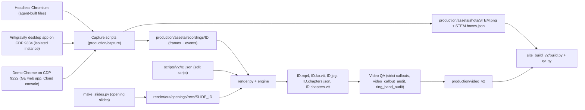

# How the videos were made

This page explains, end to end, how the 21 tutorial videos of the Hands-on Lab portal were produced:
2 opening talks, 9 Gemini Enterprise (GE) lab videos and 10 Antigravity (AG) lab videos.
Everything described here is implemented in this repository:

| Layer | Folder | README |
|---|---|---|
| Capture (real product UI → recordings + stills) | `production/capture/` | [capture/README.md](../production/capture/README.md) |
| Opening-talk slides (own graphics → pseudo recordings) | `production/render/out/openings/` | this page, [§4](#4-opening-talks) |
| Render (edit script → finished video) | `production/render/` | [render/README.md](../production/render/README.md) |
| QA (callout and ring audits) | `production/qa/` | [qa/README.md](../production/qa/README.md) |

The shipped videos are in Korean (narration, burned-in captions, on-screen labels). For the per-video catalog see
[VIDEOS.md](VIDEOS.md); for what an English edition has to change see [LOCALIZATION.md](LOCALIZATION.md).
The overall system is described in [ARCHITECTURE.md](ARCHITECTURE.md) and the lab content in [AGENDA.md](AGENDA.md).

> [!IMPORTANT]
> **No media is in this repository.** Recordings (`production/assets/recordings/`), stills (`production/assets/shots/`),
> rendered videos (`production/video_v2/`), opening-slide frames (`production/render/out/openings/recs/`), render caches
> (`production/render/cache/`) and QA output (`production/qa/out/`) are all generated locally. You re-create them by running
> the pipeline against **your own** Gemini Enterprise app, Antigravity install and Google Cloud project.

**Output format** (from `render.py`, confirmed with `ffprobe` on a rendered file): 1920×1080, 30 fps, H.264 High / yuv420p / BT.709,
AAC-LC 48 kHz stereo at 160 kbps, `+faststart`; plus a WebVTT caption file, a JPEG poster and per-step chapter files.

**Contents**

1. [Principles](#1-principles)
2. [Pipeline at a glance](#2-pipeline-at-a-glance)
3. [Capture layer](#3-capture-layer)
4. [Opening talks](#4-opening-talks)
5. [Render layer](#5-render-layer)
6. [Video QA](#6-video-qa)
7. [Recipe: produce one lab video](#7-recipe-produce-one-lab-video)
8. [See also](#8-see-also)

---

## 1. Principles

These rules were enforced for every lab. Most of them exist because a real mistake happened once.

### 1.1 Real screens only

- Every pixel of product UI (Gemini Enterprise web app, Antigravity desktop app, Google Cloud console) comes from a **real
  recording or capture** of the live product. Nothing is mocked up. Title cards, captions, rings, labels and badges are
  overlays drawn by the renderer and look like overlays.
- The company in all labs is the fictional **Cymbal** (Korean transliteration 심벌). All lab files and numbers are synthetic.
  No real customer or company names appear in prompts, data or footage.
- Opening-talk slides are designed graphics only — no product UI, no logos ([§4](#4-opening-talks)).

### 1.2 Callout boxes are measured, never eyeballed

A callout (highlight box on a still, highlight ring in a video) must sit exactly on the thing its label names.

- **New stills**: capture helpers save DOM boxes next to the PNG. `shot(name, targets={"label": locator, ...})` in
  `agy/agrec.py` and `agy/gconsole.py`, `Showcase.still(stem, targets, source)` in `agy/showcase.py`, and the `shot()` wrapper in
  `agy/ge_voc_agent.py` write `production/assets/shots/<stem>.boxes.json` (CSS px of the 1440×810 viewport).
  The plain `GE.shot()` in `capture/ge.py` writes only the PNG.
- **Existing stills**: `python3 production/qa/find_text.py <stem> "on-screen text"` runs Apple Vision OCR and prints CSS-px
  boxes. `python3 production/qa/proof.py <stem> x,y,w,h --box x,y,w,h --out <file.jpg>` makes a zoomed proof image.
- **Label = what is visibly inside the box.** A box must not cover a neighbouring row or menu item, and must not cover
  only half of its target. Portal still callouts use `pos` = `above` | `below` | `inside` only.
- **Still-callout gates** (all three must pass after any still callout is added or changed):
  1. `python3 production/site_build_v2/build.py` — fails on boxes outside the capture, an unknown `pos`, or a CSS class collision.
  2. `python3 production/site_build_v2/qa.py --callouts-only` — real browser at desktop (1440×900) and mobile (390×844),
     inline and in the lightbox; box error must be ≤ 1.5 px and no label chip may be clipped.
  3. `python3 production/qa/callout_audit.py --track <ge|ag> --labs <labN>` — OCR check plus contact sheets in
     `production/qa/out/stills/sheet_*.jpg`. **Every sheet is looked at.**
- **Video callouts**: prefer `"at": "click:<label>"` / `"target:<label>"` — boxes recorded together with the capture events —
  over hand-typed `box_css`. Then run the video gates in [§6](#6-video-qa).
- Portal callout CSS classes are named by a hash of the geometry (`build.py`), not by lab/step id. Both tracks have
  `lab1`…`lab9`, and id-based class names once made AG boxes appear on GE screenshots. Do not revert this.

### 1.3 Results are shown big

Labs that build something show the **finished result** large, on the lab page and in the video.

- In the current scripts, `ag4`, `ag7`, `ag8`, `ag10` and `ge5` open with a labelled result-preview segment right after the
  title card, and `ag9` opens on the published agent answering in Gemini Enterprise. The finished result also appears near
  the end of the video.
- Agent-built files (the AG Lab 4 dashboard, the AG Lab 7 slide deck, the AG Lab 8 evaluation report) are filmed by
  **showcase captures**: a separate headless Chromium opens the real file at 2× and records page content only — no address
  bar, no local paths ([§3.6](#36-showcase-captures-of-agent-built-results)).

### 1.4 Broken AI output is never used

- An answer or artifact with raw `<br>`, `**` or `|---` inside a table, or garbled text/typos inside a generated image
  (slides, infographics), is not published. Fix the prompt (for example "column names + one short sentence per cell",
  spell out product names), regenerate, recapture, and re-render every video that contains the scene.
- `capture/v2/ge5.py` enforces this for the Gemini Notebook answer: it stops with `broken markdown in notebook answer` when
  such markup is visible on screen.

### 1.5 Privacy hygiene during capture

- Capture only through CDP (the target page or recording window) or the headless showcase browser. Never take OS-level
  screenshots or screen recordings of the desktop.
- Use a clean demo GE app containing only Cymbal content, and keep its chat history clean (`capture/v2/chats.py delete …`) —
  the sidebar shows chat titles.
- The Antigravity recording instance runs with its own HOME, Electron profile and workspace; no conversation history of your
  own app is copied into it.
- Leak scans run during capture ([§6.5](#65-leak-scans)). Intervals that must never be shown are bracketed by
  `cut_start` / `cut_end` events and are left out of the edit scripts.
- Anything typed on camera is visible in the video (for example the lab project values typed in AG Lab 6). Use a dedicated
  demo project.

### 1.6 Completion criteria per lab

A lab is done when all of these hold:

- `build.py` finishes with **0 warnings**, and `site_build_v2/qa.py` passes;
- every callout sheet (stills and video) has been reviewed;
- `ring_band_audit.py` reports **FAIL 0** for the lab video;
- the video has **one chapter per lab step** (`tools/chapters.py` refuses a script that does not list every step exactly
  once; `build.py` warns about steps without a chapter);
- the finished result is shown big.

---

## 2. Pipeline at a glance



| Stage | Input | Output | Main code |
|---|---|---|---|
| Capture | live product UI | recording folders, stills + DOM boxes | `capture/ge.py`, `capture/v2/*.py`, `capture/agy/*.py` |
| Opening slides | HTML generated in Python | pseudo recordings | `render/out/openings/make_slides.py` |
| Edit | recordings + event log | edit script JSON | `render/scripts/v2/*.json` (21 files) |
| Render | edit script | mp4, VTT, poster, chapters | `render/render.py`, `render/engine/*` |
| Video QA | edit script + render plan | contact sheets, reports | `render.py --strict-callouts`, `qa/*.py` |
| Publish | `production/video_v2/` | portal pages | `site_build_v2/build.py` |

---

## 3. Capture layer

### 3.1 One coordinate space

Every capture uses a **1440×810 CSS-px viewport** (set with CDP `Emulation.setDeviceMetricsOverride`, DPR 2):

| Artifact | Pixel size | How |
|---|---|---|
| Screencast frames (GE, console, Antigravity) | 1440×810 or 1920×1080 JPEG | CDP `Page.startScreencast` with `maxWidth`/`maxHeight` 1920×1080. Depending on the target, frames arrive CSS-sized (1440×810) or DPR-scaled and capped (1920×1080); both occur in the shipped recordings (e.g. GE Lab 1 and the console recording are 1440×810, the Antigravity recordings 1920×1080) |
| Stills | 2880×1620 PNG | CDP `Page.captureScreenshot` at DPR 2 |
| Showcase recordings | 2880×1620 JPEG | repeated `Page.captureScreenshot` in a headless browser; `meta.json` declares `css_width` 1440 |
| Opening-slide frames | 2160×1215 JPEG | Playwright screenshots of 1200×675 CSS slides at DPR 1.8 |

All boxes — event boxes, `boxes.json`, `box_css` in edit scripts — are **CSS px of the 1440×810 viewport**. The renderer
converts them with `css_scale = frame width / css_width` (`engine/recording.py`; `css_width` defaults to 1440).

### 3.2 The GE driver — `capture/ge.py`

`GE` is an async context manager built on Playwright's `connect_over_cdp`. All other drivers subclass it, so they share the
same API and event conventions.

| Member | What it does |
|---|---|
| `CDP_URL` / `APP_HOME` | `GE_CDP_URL` (default `http://localhost:9222`); `https://vertexaisearch.cloud.google.com/us/home/cid/<GE_APP_CID>` |
| `__aenter__` | attaches to the first browser context, reuses a tab whose URL contains the app id (else opens one), sets the 1440×810 @ DPR 2 viewport |
| `goto(url, wait, sidebar)` | navigates, waits, expands the left navigation (`ensure_sidebar`), injects the demo cursor |
| `install_cursor()` / `hide_cursor()` | injects a visible 28×28 CSS-px arrow and a blue click ripple (CDP screencasts do not include the OS cursor) |
| `vis(selector)`, `vis_label(label)`, `vis_text(text)` | first *visible* element (shadow DOM is pierced) |
| `move_to(loc)` | scrolls into view, eases the mouse to the element centre (22 steps) |
| `click(loc, label)` | `move_to`, then records a `click` event with the element's DOM box, then mouse down/up |
| `type_text(text, label)` / `insert_text(text, label)` | typed input (`type_start`/`type_end`) or paste-like insert (`paste`) |
| `wait_answer_done(...)` | marks `wait_start`, polls until no visible Stop control and page text stable for `stable` s (default 5, timeout 240), marks `wait_end` |
| `shot(name, clip, full)` | DPR-2 PNG still → `production/assets/shots/<name>.png`, plus a `shot` event |
| `brand_scan(extra)` | scrolls the chat top→bottom and returns visible strings containing a real brand name ([§6.5](#65-leak-scans)) |
| `start_recording(quality=88)` | starts the JPEG screencast (max 1920×1080, every frame), marks `rec_start` |
| `set_rate(every_nth)` | restarts the screencast with frame decimation (used during long AI waits) |
| `mark(kind, **kw)` | appends an event `{"t", "wall", "kind", ...}`; `wall` uses the same epoch clock as the screencast frame timestamps |
| `stop_recording(name)` | marks `rec_stop`, writes the recording folder ([§3.3](#33-recording-format)) |

Helpers used by the GE scripts:

| File | Contents |
|---|---|
| `capture/helpers.py` | `DUMP_JS` (list clickable elements), `FIND_TEXT_JS` (boxes of exact text nodes), `MEDIA_JS` (count generated images/videos), `type_prompt` (multi-line typing with Shift+Enter), `smooth_scroll`, `click_xy`, `click_text`, `submit` |
| `capture/media_wait.py` | `wait_media(ge, kind, count)` — waits until N generated images or videos are rendered, between `wait_start`/`wait_end` events |
| `capture/nb_explore.py` | off-camera explorer for the Gemini Notebook iframe: one action per call, prints controls, saves a low-res JPEG to `production/assets/shots/_explore/` |
| `capture/v2/probe.py` | off-camera probe: `home`, `goto`, `menu`, `clicktext`, `clickxy`, `key`, `js`, `texts`, `--shot NAME` |
| `capture/v2/chats.py` | chat housekeeping (not recorded): `list`, `delete <substr>…`, `scan <substr>` |

### 3.3 Recording format

```text
production/assets/recordings/<id>/
  frames/000000.jpg …      screencast or screenshot frames
  frames.json              [{"file": "000000.jpg", "ts": <epoch seconds>}, …]
  events.json              [{"t": <s since start>, "wall": <epoch s>, "kind": "click", "label": "…", "box": {x, y, width, height}}, …]
  meta.json                optional (showcase only): {"css_width": 1440, "css_height": 810, "dpr": 2, "source": "…"}
production/assets/shots/<stem>.png           2880×1620 still
production/assets/shots/<stem>.boxes.json    {"viewport": [1440, 810], "targets": {label: [x, y, w, h]},
                                              "leaves": [{"t", "a", "tag", "role", "b": [x, y, w, h]}], "source"?: "…"}
```

`leaves` lists every visible text leaf (or element with `aria-label`/`title`) with its CSS-px box — the ground truth for
authoring callouts later.

**Rec time** = seconds since the first frame (`frames.json` `ts` − first `ts`); event times are `wall` − first `ts`.
Event kinds written by the capture code:

| Kind | Written by | Extra fields | Used by the renderer for |
|---|---|---|---|
| `rec_start`, `rec_stop` | all drivers | — | `rec_stop` extends the clip duration; usable as a time reference (`"to": "rec_stop"`) |
| `click` | `GE.click`, `click_xy`, `click_box`, … | `label`, `box` | 1× protection window, default callout box, demo-cursor position |
| `hover` | most scripts | `label`, `box` | 1× protection window, demo-cursor position |
| `type_start` / `type_end` | `type_text`, `type_prompt` | `label`, `chars` | typing speed cap |
| `paste`, `submit` | `insert_text`; `submit()` and scripts | `label` | 1× protection window |
| `wait_start` / `wait_end` | `wait_answer_done`, `wait_agent`, `wait_media` | `label`, `secs` | AI waits are time-lapsed hardest |
| `target` | `mark_target`, `Showcase.target`, scripts | `label`, `box` | callout / zoom reference with a measured box (`target:<label>`) |
| `shot` | `GE.shot` | `name` | glitch-frame removal around DPR-2 stills |
| `select`, `key`, `scroll` | `showcase.py`, `agrec.py` | `label`, `value` / `key` / `y` | references |
| `cut_start` / `cut_end` | `agv.py` (`l6_install`) | `label` | marks footage that must be cut |
| `rate`, `reconnect`, `view`, `upload`, `login_done` | various | — | informational, usable as references |

### 3.4 GE lab scripts — `capture/v2/`

One script per GE lab. Each records one or more clips; command-line letters select clips (no argument = the default set).
The GE UI is recorded in Korean (`?hl=ko`).

| Script | Args (default) | Recordings → what is on screen |
|---|---|---|
| `ge1a_welcome.py` | — | `ge1a_welcome`: first-visit welcome dialog → Start → home (one-shot: the dialog appears only on the very first visit) |
| `ge1bcd.py` | `b c d` | `ge1b_tour`: sidebar and composer tour · `ge1c_settings`: Settings › Design (theme, density, home elements) › Personalization (name, role, industry, memory) · `ge1d_firstchat`: model menu → first question → answer → answer tools → new chat |
| `ge1e_answer_tools.py` | — | `ge1e_answer_tools`: copy/download table, copy response, ⋮ options, suggested follow-ups, chat actions menu (reopens the `ge1d` chat) |
| `ge2.py` | `a b e c d` | `ge2a_vague`: vague question → generic answer (retaken up to 4× if the answer names real brands) · `ge2b_good`: check Sources (Google Search) → four-part prompt → cited answer · `ge2e_sources`: reasoning panel, citation chips and source cards · `ge2c_followup`: follow-up (three ad-copy options) · `ge2d_share`: actions menu → rename → share link |
| `ge3.py` | `a b c d` | `ge3a_upload`: pick Gemini 4 Argon → upload the sales workbook → analysis ideas · `ge3b_analysis`: revenue / target-attainment table + hypotheses · `ge3c_chart`: online-share trend chart · `ge3d_canvas`: Canvas report deck → flip slides → export menu |
| `ge4.py` | `a b c d` | `ge4a_brief`: upload product brief PDF → key-visual prompt · `ge4b_image`: Tools › Create image (Nano Banana) · `ge4c_edit`: follow-up edit (evening mood, mood light) → zoom/download menu · `ge4d_video`: Tools › Create video (Veo 3.1) → 8-second teaser → playback |
| `ge5.py` | `a2 b c s` (`c s`) | `ge5a2_dr_go`: Start research → live web research · `ge5b_dr_result`: finished report tour (title, table, citation hover, conclusion; `--probe` only prints scroll targets) · `ge5c_notebook`: new Gemini Notebook → upload brief → grounded question → sources (stops on broken markdown) · `ge5d_studio`: each finished Studio output of the same notebook |
| `ge6.py` | `a b c` | `ge6a_skill_upload`: upload the report-style skill ZIP · `ge6b_skill_use`: invoke it with `/` to turn meeting notes into a report · `ge6c_tips_tour`: library, projects, search, agents |
| `ge7.py` | `a b c d` | `ge7a_build`: New agent › Chat agent → attach policy PDF → generate from a description · `ge7b_test`: two preview questions → Flow tab · `ge7c_create`: agent-node settings (instructions, model, knowledge) → Create · `ge7d_use`: chat with the agent → @-mention it from home |
| `ge7_refine.py` | `open instr model know starter sub sub2 schedule preview` (all) | `ge7e_open_edit` · `ge7f_node_instructions` · `ge7f2_model_menu` · `ge7g_node_knowledge` (remove connector, upload PDF) · `ge7g2_starter_prompt` · `ge7h_subagent` · `ge7h2_subagent2` (second policy PDF, second sub-agent, connector dialog, three-node view) · `ge7h3_schedule` (schedule form, then Cancel) · `ge7i_preview_update` |
| `ge8.py` | `a b c` | `ge8a_build`: New agent › Workflow from a description · `ge8b_edit`: add an urgency step via chat → trigger/step settings · `ge8c_test`: Test tab → run → step results and reply draft → enable |
| `ge8_refine.py` | `enable trigger step step_file_schema flow_menu approval branch reject_branch test update` (all) | `ge8c2_enable` (publish version 1) · `ge8d_trigger` (start time 08:30) · `ge8e_step` · `ge8e2_step_file_schema` (attach file, structured-output schema editor) · `ge8f0_flow_menu` · `ge8f_approval` (human-in-the-loop approval node) · `ge8g_branch` (approved branch → Gemini agent) · `ge8g2_reject_branch` (existing ADK agent on approved, request-info on rejected) · `ge8h_test_approval` (saved as `ge8h_test_noapproval` if no Approve button appears) · `ge8i_update` (version 2) |
| `ge9.py` | `a b c` | `ge9a_gallery`: agent gallery and pinning · `ge9b_manage`: own agent ⋮ menu → edit / versions → @-mention · `ge9c_combo`: @-mention an ADK agent, then a follow-up with the `/cymbal-report-style` skill |

Some scripts store the URL of a conversation in `production/assets/recordings/<name>_session.txt` (`ge3`, `ge4`, `ge5`) so
later clips can reopen it. These files contain your app's URLs and are not part of the repository.

> [!NOTE]
> `ge5.json` also uses a recording `ge5a_dr_start` (Deep Research from the sidebar → request → research plan, as listed in
> the docstring of `ge5.py`) that no script in this repository produces; `ge5.py` parts `a2` and `b` expect that
> conversation's URL in `production/assets/recordings/ge5_dr_session.txt`.

### 3.5 Antigravity desktop app (AG Labs 3–10)

**Launcher — `capture/agy/launch_ag_rec_voc.sh`** starts an isolated, recording-only instance of the Antigravity desktop app:

- Isolated HOME (`$AG_REC_HOME/home`) and Electron profile (`$AG_REC_HOME/profile`). From your own app only account and
  installation ids, app settings and the sign-in state are copied — no caches, backups, workspace storage or conversation
  history.
- Your gcloud config is synced into the isolated HOME (project `LAB_PROJECT_ID`, account `REC_ACCOUNT`) and Application Default
  Credentials are created for `REC_ACCOUNT` with quota project `LAB_PROJECT_ID`, so MCP servers that use Google credentials
  (BigQuery) work. Your global gcloud configuration is not modified. This refresh runs on every launch.
- The window is pinned to **exactly 1440×810 at zoom level 0** (`window.zoomLevel` and the saved window state are rewritten),
  so DOM boxes, stills and screencast frames share one coordinate space.
- Workspace `$AG_REC_HOME/work/cymbal-voc` is copied once from `production/samples/v2/build/cymbal-voc` and initialised as a
  git repository; the recordings build on it lab by lab.
- CDP on port **9334**; the app starts in a new session so the launching shell cannot kill it. If the port is already in
  use the script prints `already running` and exits — never run two launchers at once.
- `GOOGLE_API_USE_CLIENT_CERTIFICATE=false` is exported for every process the agent starts (a quirk of the recording
  machine; harmless elsewhere).

**Driver — `capture/agy/agrec.py`** (`AGRec`, a `GE` subclass) attaches to the app's main workbench window on `AG_CDP_URL`
(default `http://localhost:9334`) and adds:

| Member | What it does |
|---|---|
| `measure_viewport()` | warns if the real CSS viewport is not 1440×810 and scales recorded boxes by `1440 / innerWidth` |
| resilient recording | frames are always written; a dropped CDP session is reconnected and the screencast resumed; an aborted take is saved as `<name>_aborted` |
| `shot(name, targets=…)` | DPR-2 still + `<name>.boxes.json` (named targets + every visible text leaf) |
| `mark_target(label, loc)` | `target` event with the measured box → use `"at": "target:<label>"` in edit scripts |
| `click_xy`, `hover`, `hover_xy`, `press`, `submit` | input with events and DOM boxes |
| `approve_command()` | answers the "Allow running this command?" card (Yes, allow this time → Submit) |
| `auto(...)` | `on_tick` handler that approves commands / clicks Accept all / Proceed automatically |
| `wait_agent(...)` | waits until output is stable and no Stop/Cancel control is visible; re-checks for a while because an agent can resume after a background command; warns on queued messages |

**Storyline recordings — `capture/agy/agv.py`**: `python3 production/capture/agy/agv.py <step> [<step> …]`.
Prompts are module constants (typed on camera, in Korean).

| Lab | Steps | Recordings |
|---|---|---|
| 3 | `l3_open` (trust dialog, request doc, CSV) · `l3_setup` (Auto Execution / Review Policy = Request Review, model) · `l3_ask` (@-mention + question, command approval) · `l3_verify` (recompute with a terminal command) · `l3_plan` (`/plan`, feedback, updated plan) · `l3_plandoc` | `ag3v_open`, `ag3v_setup`, `ag3v_ask`, `ag3v_verify`, `ag3v_plan`, `ag3v_plandoc` |
| 4 | `l4_build` (Proceed, approvals, review, Accept all) · `l4_settings` (Always Proceed) · `l4_browse` (`/browser` check + report artifact) · `l4_iterate` (filters) · `l4_verify` | `ag4v_build`, `ag4v_settings`, `ag4v_browse`, `ag4v_iterate`, `ag4v_verify` |
| 5 | `l5_rules`, `l5_rules_file` (AGENTS.md) · `l5_check` · `l5_skill`, `l5_skill_file` (SKILL.md) · `l5_use` · `l5_slash` · `l5_custom` (Customizations) | `ag5v_*` |
| 6 | `l6_env` (lab.env + BigQuery load) · `l6_install` (MCP Store → BigQuery → Install → Tools → raw config) · `l6_query` · `l6_insight` · `l6_skill` · `l6_run` | `ag6v_*` |
| 7 | `l7_slides` · `l7_pdf` · `l7_edit` · `l7_view` | `ag7v_slides`, `ag7v_pdf`, `ag7v_edit`, `ag7v_view` |
| 8 | `l8_create` · `l8_tools` · `l8_run` · `l8_eval` (agents-cli) | `ag8v_*` |
| 9 | `l9_deploy` · `l9_iam` · `l9_publish` | `ag9v_deploy`, `ag9v_iam`, `ag9v_publish` |
| 10 | `l10_schedule` (`/schedule`, Scheduled card, Send Now) · `l10_sub` (two subagents, merged report, README section) | `ag10v_schedule`, `ag10v_sub` |

Operational rules learned during recording (enforced in code where possible):

- **A new conversation per step.** If the agent leaves a background command running, the next prompt in the same
  conversation is held under "Queued Messages". Most steps pass `new=True` (the default of `ask_mcp`), and both
  `ask_and_wait` and `ask_mcp` raise an error when "Queued Messages" appears.
- **`/schedule` conversations stay busy** (the cron job keeps them working), so a new message there is always queued — use
  **Send Now** (`open_schedule_card` does this).
- **MCP auth expiry** shows a red "MCP Error" under the input box. For MCP takes run `gcloud auth login <account>` and
  relaunch the launcher (it refreshes gcloud and ADC). For takes that do not use MCP you can temporarily remove the server
  from the recording instance's MCP configuration and refresh (back it up, restore it afterwards).
- **A subagent sometimes never starts** (Lab 10). Restart the app with the launcher and retake.
- `prep_editor()` keeps a harmless workspace file open so the take never shows an empty editor or a file outside the
  workspace (which would show a local path).
- The MCP Store briefly lists non-public servers before the search filter applies; `l6_install` brackets that moment with
  `cut_start` / `cut_end` and the edit script must skip it.

**Legacy instance (AG Lab 2 sign-in clip)**: `capture/agy/launch_rec.sh` starts an isolated instance on CDP **9333**
(optionally blocking the auto-updater host via `AG_BLOCK_UPDATER_HOST`, because an update mid-take shut down the language
server); `capture/agy/agy.py` (`AGY`, `AGY_CDP_URL`) drives it; `capture/agy/ag2a_signin.py` records `ag2a_signin`: the script
clicks "Continue with Google", a person completes the Google sign-in in the browser, and recording continues through
onboarding (stills `ag_2_01…03`).

### 3.6 Showcase captures of agent-built results

`capture/agy/showcase.py` (`Showcase`, a `GE` subclass) films a **real output file** in its own headless Chromium:

- viewport 1440×810 at DPR 2; frames are `Page.captureScreenshot` JPEGs (2880×1620), taken continuously while something
  moves (`fast()` windows around input) and about 3 per second during static holds;
- an input lock guarantees that a capture never overlaps a mouse press;
- every input records an event with its DOM box (`hover`, `click`, `select`, `key`, `scroll`, `target`);
- `stop_rec(name, source)` writes `frames.json`, `events.json` and `meta.json` (css_width 1440 → css_scale 2.0);
- `still(stem, targets, source)` writes the PNG and `<stem>.boxes.json`;
- `scan()` refuses to capture a page whose text contains `/Users/`, `/home/`, `file://` or a `LEAK_DENYLIST` term.

| Script | Opens | `rec` → recording | `stills` → stills |
|---|---|---|---|
| `ag4_dash.py [rec\|stills\|all]` | the dashboard the agent built (`index.html` + `app.js` + CSV), served from the workspace by a temporary `127.0.0.1` HTTP server | `ag4v_dash` (targets labelled `D …`, tagged per filter state) | `ag_4v_20…24` |
| `ag7_deck.py [rec\|stills\|all]` | `slides/weekly_2026-10-19.html` (override with `AG7_DECK`) in presentation mode | `ag7v_deck` (targets `S<n> …` per slide) | `ag_7v_21…26_deck_s1…s6` |
| `ag8_eval.py [rec\|stills\|all]` | the HTML report written by `agents-cli eval run` | `ag8v_score` (targets `E …`) | `ag_8v_09_scores`, `ag_8v_10_trace`, `ag_8v_11_case1` |

`ag7.json` also uses `ag7v_before` (the deck before the Lab 7 edit) and `ag7v_template` (the company deck template), as
described in `production/content/v2/ag_labs/lab7.py`. The command line of `ag7_deck.py` records only `ag7v_deck`; its
`record()` function takes a `name` argument and `AG7_DECK` selects the file, but no entry point for these two takes is in
the repository.

### 3.7 Google Cloud console and the published GE agent

- `capture/agy/gconsole.py` (`GC`) drives the Cloud console in the demo Chrome (CDP 9222) **in its own window**
  (`Target.createTarget` with `newWindow`); the window id is kept in `production/capture/agy/.gc_target` so later runs reuse
  it, and the GE tabs are never touched. It adds measured-box helpers: `shot(targets=…)` with `boxes.json` (walks shadow
  roots), `lb()` (box of the deepest element with a given text, with ancestor/size filters), `rb()`, `union()`,
  `click_box`, `hover_box`, and deterministic eased scrolling of a tagged scroller.
- `capture/agy/ag1r_console.py stills|record` — AG Lab 1 admin screens (Gemini Enterprise › Settings › AI developer tools,
  Developer tools metrics) for project `LAB_PROJECT_ID`, location `us`. Read-only: edit panels are opened and always closed
  with Cancel; nothing is saved. Stills `gc_ag_1r_01…08`, recording `ag1r_console`.
- `capture/agy/ge_voc_agent.py [agents|ask|all]` — AG Lab 9: finds the published agent's card on the GE agents page, opens
  it, asks a question, waits for the answer and runs the brand scan (recording `ag9v_ge_agents` with `agents`, otherwise
  `ag9v_ge_use`; stills `ag_9v_05…08` with `boxes.json`).

### 3.8 What the capture layer writes

| Path (repo-relative) | Content | In the repo? |
|---|---|---|
| `production/assets/recordings/<id>/` | frames, `frames.json`, `events.json`, optional `meta.json` | no |
| `production/assets/recordings/*_session.txt` | conversation URLs for multi-clip GE labs | no |
| `production/assets/shots/<stem>.png` (+ `.boxes.json`) | stills (prefixes `ge_`, `ag_`, `gc_`) | no |
| `production/assets/shots/_explore/`, `_ge8_progress/` | exploration / progress snapshots | no |
| `production/capture/agy/.gc_target` | console window id | no |

---

## 4. Opening talks

The two opening videos (`ge_opening`, `ag_opening`) mix designed slides with short real UI clips.

`production/render/out/openings/make_slides.py [slide_id …]` renders own-designed HTML slides (design tokens from
`production/DESIGN_v2.md`; no product UI, no logos) into **pseudo recordings** that `render.py` treats like any other
recording:

- 16 slides: `ge_s_shift`, `ge_s_gate`, `ge_s_features`, `ge_s_prompt`, `ge_s_safety`, `ge_s_labs` and `ag_s_shift`,
  `ag_s_family`, `ag_s_story`, `ag_s_loop`, `ag_s_safety`, `ag_s_custom`, `ag_s_mcp`, `ag_s_adk`, `ag_s_signin`, `ag_s_labs`.
- Each slide has build steps: elements with `data-step="k"` become visible from state *k* on. Headless Chrome (Playwright,
  channel `chrome`) screenshots every state at 1200×675 CSS × DPR 1.8.
- State *k* is shown from rec time *k* × 2.0 s, with 5 crossfade frames in the 0.2 s before it; the last state stays on
  screen for 8 s (its 2 s step plus a 6 s hold). `events.json` contains only `rec_start` / `rec_stop`, so narration anchors
  to a build step with `"at": k*2.0`.
- Output: `production/render/out/openings/recs/<slide_id>/` (`frames/*.jpg`, `frames.json`, `events.json`) and
  `production/render/out/openings/slides/<slide_id>.html` + `preview_<slide_id>.jpg` (1280 px). None of these are in the repo.

The opening scripts reference slides with a path relative to the recordings folder, for example
`"rec": "../../render/out/openings/recs/ge_s_shift"`, and interleave them with clips from the lab recordings
(`ge_opening`: 18 segments; `ag_opening`: 35 segments). Openings have no `chapters`.

---

## 5. Render layer

### 5.1 Running `render.py`

```bash
python3 production/render/render.py production/render/scripts/v2/<id>.json [options]
```

| Option | Effect |
|---|---|
| *(none)* | full render → `<out>/<id>.mp4`, `<id>.ko.vtt`, `<id>.jpg`, and `<id>.chapters.json/.vtt` if the script has `chapters` |
| `--dry-run` | build the plan and print the timeline (segment times, rec ranges, time-remap pieces, sync points, badges, callouts, sentence times). TTS is synthesized and cached. |
| `--stills 1.5,4,7.2` / `--stills-every 0.5` | render only these global timestamps (s) as PNG → `production/render/out/<id>/still_<t>s_f<frame>.png` |
| `--callout-qa` | render 3 frames of every callout, write `production/render/out/<id>/<id>_callouts.jpg` + `.json`, then exit |
| `--strict-callouts` | run the same callout QA first and abort if any callout fails; otherwise continue |
| `--fast` | quick preview encode (x264 `veryfast`, crf 23, no size loop) |
| `--no-bgm` | no music bed |
| `--workers N` | parallel frame renderers (default `max(2, min(8, cpu_count − 4))`) |
| `--out DIR` | output directory (default `site/assets/video`; the v2 portal reads `production/video_v2`) |

### 5.2 Engine modules

| Module | Role |
|---|---|
| `engine/common.py` | paths (`RECS_DIR`, `CACHE_DIR`, `OUT_DIR`, `SITE_VIDEO_DIR`), 1920×1080 canvas, `DEFAULT_VOICE`, quota project (`TTS_PROJECT`), easing curves, design colours, WAV I/O |
| `engine/recording.py` | loads a recording, drops off-size and glitch frames around stills, static-interval detection, event/time/box reference resolution, demo-cursor position |
| `engine/timeline.py` | edit script → frame-accurate plan: TTS scheduling, sync points, time remapping, camera track, callouts (+ tracking), labels, badges, caption cues, poster time |
| `engine/callout_track.py` | per-callout template tracking on the frames actually shown, visibility, QA summary |
| `engine/compositor.py` | per-frame drawing in worker processes: background, device frame and shadow, warped recording, spotlight/ring/chip, badge, step label, crossfades, captions, fades |
| `engine/typo.py` | Pretendard typography and SDF-antialiased sprites (captions, chips, badges, labels, card text, brand line), cached as PNG |
| `engine/tts.py` | per-sentence TTS front end: lexicon, cache key, `TTS_REUSE`, parallel synthesis |
| `engine/voice.py` | Gemini TTS narrator: style prompt, comma-pause shaping, ASR verification, best-take selection |
| `engine/music.py` | Lyria music bed, looping, ducking mix, two-pass loudness normalisation |
| `tools/chapters.py` | per-step chapter files from a script, without re-rendering |

### 5.3 Edit-script format

Scripts live in `production/render/scripts/v2/<id>.json` (21 files: `ge1`–`ge9`, `ag1`–`ag10`, `ge_opening`, `ag_opening`).

#### 5.3.1 Top level

| Key | Default | Meaning |
|---|---|---|
| `id` | **required** | output basename |
| `segments` | **required** | list of segments (played in order with crossfades) |
| `title` | `id` | `NOTE` line in the VTT |
| `track`, `lab` | — | content module (`production/content/v2/<track>.py`) and lab id used for chapter titles |
| `brand` | — | text-only brand line top-left on title/card/outro (v2: "Gemini Enterprise 핸즈온 랩" / "Antigravity 핸즈온 랩", i.e. "… Hands-on Lab"); stays fixed across consecutive title/card/outro segments |
| `voice` | `Kore` | Gemini TTS voice (legacy Chirp 3 names map to `Kore`); per-segment `voice` overrides |
| `speaking_rate` | 1.0 | part of the TTS cache key only — not sent to the model |
| `lexicon` | `true` | `true` = `production/render/lexicon.json`, `false` = none, a repo-relative path, or an inline dict |
| `bgm` | `true` | `true`, `false`, or `{"prompt", "negative_prompt", "seed", "bed_db": -10, "duck_db": -22, "fade_in": 1.5, "fade_out": 2.5}` |
| `captions` | `true` | burned-in captions + VTT cues; also keeps zoom targets above the caption band |
| `transition` | 0.5 | crossfade between segments (s) |
| `poster` | auto | poster time (s); default about 2.6 s into the title card, else the middle of the first screen segment |
| `fade_in` / `fade_out` | 0.4 / 0.8 | picture fade at start / end |
| `encode` | `{"crf": 24, "preset": "slow", "audio_kbps": 160, "max_mb": 30}` | x264/AAC settings and size cap ([§5.3.11](#5311-encode)) |
| `chapters` | — | step → segment mapping ([§5.3.10](#5310-chapters)) |
| global tunables | see right | `fps` 30, `gap` 0.42, `lead` 0.30, `tail` 0.30, `max_speed` 8, `min_speed` 0.8, `type_speed` 1.6, `idle_speed` 2.0, `frame_scale` 0.84, `frame_top` 40, `caption_band` 150, `max_zoom` 1.6, `caption_max_w` 1500 |

All 21 v2 scripts set `track`, `brand`, `bgm: true`, `captions: true` and `encode`; the 19 lab scripts also set `lab` and
`chapters`. None sets `voice`.

#### 5.3.2 Segment types

| `type` | Keys | Notes |
|---|---|---|
| `title` | `kicker`, `title`, `subtitle`, `duration` (3.5), `narration` | dark background with drifting Gemini-gradient glows, gradient rule under the kicker, staggered fade-up, slow push-in |
| `card` | `kicker`, `title`, `bullets`, `narration`, `duration` (2.5 + 1.0 × bullets) | numbered bullets; with exactly one sentence per bullet, bullet *i* appears when sentence *i* starts |
| `outro` | `kicker`, `title`, `subtitle`, `narration`, `duration` (4.0; with a checklist 3.8 + 0.9 × rows), `checklist`, `check_at`, `center_y` | check-mark icon; checklist rows slide in synced to narration (one sentence per row, or an intro sentence + one per row), else at sentence indices `check_at`, else staggered; the video fades to black |
| `screen` | see below | a clip of a recording inside a device frame |

`title`/`card`/`outro` also accept `brand` (override; `false` hides), `gap`, `lead`, `tail`, `transition`, `voice`,
`speaking_rate`. A segment lasts at least as long as its narration plus `lead` + `tail`.

#### 5.3.3 Screen segments

| Key | Default | Meaning |
|---|---|---|
| `rec` | **required** | recording id (folder under `production/assets/recordings/`, or a path relative to it) |
| `from` / `to` | 0 / end | rec time (s) or event reference |
| `narration` | — | sentences ([§5.3.5](#535-narration-items)) |
| `label` / `labels` | — | lower-third step labels ([§5.3.6](#536-step-labels)) |
| `zoom` | — | camera moves ([§5.3.8](#538-zoom-and-pan)) |
| `callouts` | — | highlight rings ([§5.3.7](#537-callouts)) |
| `speed`, `keep`, `badge` | `"auto"`, `[]`, `true` | time remapping ([§5.3.9](#539-time-remapping)) |
| `intro` | `"settle"` after a non-screen segment, else `"none"` | gentle 0.94 → 1.0 push-in over 1.2 s (skipped if a zoom starts in the first 0.9 s) |
| `transition` | global | crossfade *into* this segment (`0` = hard cut) |
| `duration` | — | minimum output length (s) |
| `lead`, `tail`, `gap` | global | narration padding and pause between sentences |
| `max_speed`, `min_speed`, `type_speed`, `idle_speed`, `max_zoom` | global | per-segment overrides |
| `speed_smooth` | 0.10 | Gaussian smoothing of the time map (s) |
| `corner` | 18 | device-frame corner radius (px) |
| `voice`, `speaking_rate` | script | per-segment narration voice |

#### 5.3.4 Time and event references

Anywhere a time or box is accepted you can write a rec time in seconds or an **event reference**:

```text
"click"                 a click event (see matching rules below)
"click:<label>"         exact label match, else substring match
"click:<label>#2"       the 2nd matching event in the whole recording
"target:<label> -0.4"   optional signed offset in rec seconds
"event:12"              index in events.json
{"event": "click", "label": "…", "n": 1, "offset": -1.2}
```

Any event kind works (`click`, `hover`, `target`, `submit`, `type_start`, `wait_end`, `select`, `rec_stop`, …).
Matching without `#n`: references inside a segment (narration anchors, zooms, callouts, labels) take the first match inside
the segment's rec range (±0.5 s), else the match nearest to the reference point; the segment's own `from` / `to` take the
first match in the whole recording.

#### 5.3.5 Narration items

`narration` is a string (split into sentences) or a list whose items are strings (each split into sentences) or objects
(never split):

| Key | Default | Meaning |
|---|---|---|
| `text` | **required** | caption text — the on-screen spelling |
| `say` | — | spoken text; replaces `text` for TTS and **bypasses the lexicon** |
| `at` | — | sync point: rec time or event reference |
| `align` | 0 | where in the sentence `at` must be on screen (0 = sentence start, 1 = end) |
| `offset` | 0 | extra seconds added to the alignment point |
| `pause` | segment `gap` | pause after this sentence (s) |
| `caption` | `text` | burned-in caption override (e.g. a shorter line) |

Sentence splitting uses `(?<=[.!?。…])\s+`. Each sentence is synthesized separately, so captions are timed exactly.
With `at`, the recording is time-remapped so that the referenced moment is on screen when the narration reaches
`align` × duration + `offset` of that sentence; if the visuals cannot be compressed enough, this and later sentences are
delayed. Anchors must increase in rec time; anchors outside the clip or out of order are ignored with a `WARN`.
**Keys not listed here are ignored** — in particular `rec_at` and `lead` on narration items have no effect.

#### 5.3.6 Step labels

`"label": {...}` (one) or `"labels": [...]`; a plain string is allowed. Each label: `kicker` (e.g. `"STEP 2"`), `text`,
`at` (output seconds into the segment, default 0.55), `at_rec` (rec time or event, plus `lead`), `say` (0-based sentence
index, plus `lead`; wins over the others), `dur` (3.6). Overlapping labels are trimmed so the earlier one leaves 0.25 s
before the next appears.

#### 5.3.7 Callouts

| Key | Default | Meaning |
|---|---|---|
| `at` | segment start | rec time or event reference; if it names an event with a box, that box is the default target |
| `box` | first `click` from about 1 s before `at` | `[x, y, w, h]` in recording-frame px, or an event reference |
| `box_css` | — | `[x, y, w, h]` in CSS px (× `css_scale`); overrides `box` |
| `pad` | 6 CSS px | padding on every side, in recording-frame px |
| `say` | — | 0-based sentence index; the ring appears when that sentence starts (+ `lead`) |
| `lead` | 0 | output seconds relative to `at` (or `say`); e.g. `-1.4` = 1.4 s before a click |
| `dur` | 2.4 | output seconds on screen |
| `text` | — | label chip text (none = ring only) |
| `spotlight` | `true` (0.28) | dimming outside the target; `false`/0 disables; a number sets the amount |
| `position` | `"auto"` | chip above, else below, else inside the target (`"top"` / `"bottom"` force a side) |
| `radius` | 14 | ring corner radius |
| `track` | `true` | follow the target with template tracking; `false` = static ring at the measured box |

The ring is an animated Gemini-gradient stroke (4 px) with a soft glow and pulse; the chip is a gradient pill. Rings follow
the camera and are kept at least 4 px inside the frame. A chip below the target must stay clear of the bottom 190 px
(captions).

#### 5.3.8 Zoom and pan

`zoom` is a list of `{"from", "to"?, "box" | "box_css", ...}`:

| Key | Default | Meaning |
|---|---|---|
| `from` | segment start | rec time / event where the push-in starts (+ `lead`) |
| `to` | — | rec time / event where it zooms back out (+ `lead_out`); omit to stay zoomed |
| `from_say` / `to_say` | — | 0-based sentence index instead of `from` / `to` |
| `box` / `box_css` | `"auto:click"` | target region; an event box gets context — each side padded by max(40 % of the box, 60 CSS px), at least 27 % × 28 % of the frame (`min_w` / `min_h`) |
| `scale` | — | force a magnification (relative to "recording fills the 1920 px frame") |
| `max` | `max_zoom` | per-zoom cap |
| `dur` / `dur_out` | 0.75–1.4 s / 0.75–1.3 s | move durations (scale with the zoom ratio) |
| `overscan` / `overscan_px` | `false` / caption band + 40 | let the camera move past the recording's bottom edge, for targets near the bottom |

Moves use cubic ease-in-out about the fixed point (a pure push-in). Moves never interrupt each other; a zoom that starts less
than 0.3 s after the previous `to` pans directly. Targets are framed above the 150 px caption band.

#### 5.3.9 Time remapping

`from`/`to` choose the rec range; `speed` decides how it maps onto output time:

- `"auto"` (default): output length = max(narration + `lead` + `tail`, shortest acceptable clip). If more time is needed,
  unchanging (no-repaint) stretches are held longer (if there are none, playback slows to `min_speed` and the last frame is
  held). If less time is needed, unchanging stretches shrink first (to 0.2 s each), then motion is time-lapsed with caps:
  1× around `click` (−1.0/+0.7 s), `hover` (−0.6/+0.5 s), `submit`/`paste` (−0.4/+0.9 s) and `keep` ranges; ≤ `type_speed`
  while typing; ≤ `max_speed` inside `wait_start`…`wait_end`; other motion ≤ `idle_speed` when the recording marks its waits,
  else ≤ `max_speed`. Silent segments use the shortest acceptable clip (static stretches kept ≥ 0.5 s).
- a number: uniform speed (then hold the last frame if narration is longer);
- a list `[{"from": 60.0, "to": 66.3, "x": 4}, …]`: explicit speeds per rec range (1× elsewhere).

`keep: [[a, b], …]` forces 1× for rec ranges. The time map is smoothed (0.1 s) and frames are resampled to a constant 30 fps.
A fast-forward badge ("빨리 감기 ×N", Korean for "fast-forward") appears automatically while visibly changing content plays
at ≥ 1.9× for ≥ 0.8 s (N = 90th-percentile speed; stretches less than 1.2 s apart merge); `"badge": false` disables it.

#### 5.3.10 Chapters

```json
"chapters": [{"step": 1, "seg": 2}, {"step": 2, "seg": 3}, {"step": 3, "seg": 3, "say": 4}]
```

One entry per lab step (1-based, every step exactly once — otherwise `tools/chapters.py` exits with an error). A chapter
starts at the visible start of segment `seg` (segment start + half of the incoming crossfade), or at the start of sentence
`say` of that segment minus `lead` (default 0.4 s, never before the visible start), plus `offset`; values are rounded to
0.1 s. Each chapter ends where the next one (in time order) starts; the last one ends where the outro becomes visible.
Step titles come from `production/content/v2/<track>.py` (`LABS[lab]['steps'][i]['title']`).

#### 5.3.11 Encode

```json
"encode": {"crf": 24, "preset": "slow", "audio_kbps": 160, "max_mb": 60}
```

If the mp4 is larger than `max_mb`, it is re-encoded at crf + 2, at most twice. The v2 scripts use crf 24 or 26 and
`max_mb` between 40 and 90.

#### 5.3.12 A real excerpt

Segment 4 of `scripts/v2/ag4.json` (two items trimmed, marked with `//`):

```jsonc
{"type": "screen", "rec": "ag4v_build", "from": 0.4, "to": 23.6, "speed": "auto", "max_speed": 6,
 "labels": [{"kicker": "STEP 1", "text": "계획대로 만들기 — Proceed와 변경 검토", "at": 0.5, "dur": 3.4}],
 "narration": [
   {"text": "Lab 3의 같은 대화에서, 계획서 카드 아래 Proceed를 누릅니다.",
    "say": "랩 쓰리의 같은 대화에서, 계획서 카드 아래 프로시드를 누릅니다.",
    "at": "click:Proceed", "align": 0.85},
   {"text": "에이전트가 계획서대로 만들기 시작합니다."},
   {"text": "권한이 아직 Request Review라서, 명령을 실행하기 전에 승인 카드가 뜹니다.",
    "say": "권한이 아직 리퀘스트 리뷰라서, 명령을 실행하기 전에 승인 카드가 뜹니다.",
    "at": "target:명령 승인", "align": 0.55}
   // … one more sentence anchored to "click:Submit" …
 ],
 "zoom": [{"from": 0.5, "to": "click:Proceed +0.6", "box_css": [700, 160, 740, 250]},
          {"from": "target:명령 승인 -0.4", "to": "click:Submit +0.5", "box_css": [700, 170, 740, 610], "overscan": true}],
 "callouts": [{"at": "click:Proceed", "lead": -0.9, "dur": 1.1, "text": "Proceed", "spotlight": 0.2},
              {"at": "target:명령 승인", "lead": 0.1, "dur": 1.8, "text": "Allow running this command?", "spotlight": 0.18}
              // … two more callouts on "click:허용" and "click:Submit" …
 ]}
```

What it does:

- The label reads "STEP 1 · Build as planned — Proceed and reviewing changes".
- Sentence 0 ("In the same Lab 3 conversation, press Proceed under the plan card.") is aligned so the recorded `click`
  labelled `Proceed` happens 85 % into the sentence. Its `say` spells "Lab 3" and "Proceed" phonetically for the TTS while
  the caption keeps the on-screen spelling.
- Sentence 2 is anchored to `target:명령 승인` — the `target` event "command approval" that `agv.py l4_build` recorded with
  the measured box of the "Allow running this command?" card. The callout on the same event uses that box automatically.
- The second zoom frames the approval card and may overscan past the bottom so the card is not hidden under captions.

A ring-band fix from `ag10.json` — a measured box, `"pad": 2` (recording px) instead of the default 6 CSS px, timed to
sentence 1:

```json
{"text": "Scheduled 30 8 * * 1", "lead": 0.2, "dur": 3.0, "spotlight": 0.15, "box_css": [936, 219, 131, 22], "pad": 2, "say": 1}
```

### 5.4 Narration (TTS)

| Item | Value (code) |
|---|---|
| Model | Vertex AI `gemini-3.8-flash-tts` via `generateContent` on `aiplatform.googleapis.com`, location `global` (`engine/voice.py`) |
| Voice | `Kore` (`DEFAULT_VOICE` / `VOICE`); `tts.normalize_voice` maps legacy Chirp 3 names, `Despina`, `Charon` and `default` to `Kore`, otherwise uses the last `-` part of the name |
| Style | one constant style string for every line: "Clear, warm and engaging instructor narration at a steady, moderate pace, with a brief natural pause at every comma" |
| Auth | `gcloud auth print-access-token` of the active gcloud account (pick one per command with `CLOUDSDK_CORE_ACCOUNT=<account>`; do not change your global gcloud config) |
| Quota project | `TTS_PROJECT`, else `GOOGLE_CLOUD_PROJECT` (sent as `X-Goog-User-Project` and used in the endpoint path); the same project is used for ASR and Lyria |
| Request schema | tried in order `v1` (`voice`), `v1beta1` (`prebuiltVoiceConfig`), `nostyle`; the first accepted one is reused |

**Spoken vs. caption text.** `text` is what the viewer reads; the spoken text is `say` if present, otherwise `text` passed
through the **pronunciation lexicon** `production/render/lexicon.json`: keys starting with `re:` are regular expressions
(applied first), literal keys are applied longest-first, ASCII keys match whole words only, keys starting with `_` are
comments. The v2 lexicon maps English product terms to Korean phonetics (e.g. `Gemini Enterprise` → 제미나이 엔터프라이즈,
`PDF` → 피디에프). The v2 scripts carry 435 `say` overrides for file names, slash commands, version numbers and mixed text.

**Take selection and QA** (`voice.best_take`, up to 4 takes at temperature 0.35, 0.45, 0.55, 0.65):

1. synthesize, trim silence (−45 dB; 45 ms onset and 85 ms release kept);
2. transcribe the take back with Gemini ASR (`gemini-3.8-flash`, falling back to `gemini-3.5-flash`, `gemini-2.5-flash`) and
   compare with the script: character error rate ≤ 0.08, at most 2 consecutive changed characters, no hesitation fillers, no
   spoken "short pause" tag, version numbers and months heard exactly;
3. check every comma has a pause (≥ 0.12 s) and the pacing is within bounds;
4. keep the first passing take, else the best-scoring one; then shape pauses: comma silences to 0.30–0.40 s (soft knee),
   other silences inside a sentence capped at 0.62 s, a missing comma pause gets 0.30 s inserted.

ASR is a quality gate, never a hard failure: if ASR is unavailable the take is judged on pauses and pacing only.

**Caching.** Each sentence is cached in `production/render/cache/tts/<key>.wav` + `.json` (text, model, voice, style, wav
path, duration, QA report). The key covers the engine version, model, style, comma bounds, voice, rate, **spoken text** and
sample rate — any change to the spoken text means new synthesis (a paid API call), even in `--dry-run`.

**`TTS_REUSE=1`** — for re-renders that do not change narration (boxes, zooms, timing). On a cache miss the engine reuses the
most similar cached take of the same voice (similarity ≥ `TTS_REUSE_MIN`, default 0.85) and logs `TTS reuse (<ratio>): <text>`.
With `TTS_REUSE_STRICT=1` (default) a miss without a close take aborts; with `TTS_REUSE_STRICT=0` it synthesizes.
**Always check the `TTS reuse` lines**: a reused take of a different sentence means caption ≠ voice. Re-render without
`TTS_REUSE` — exact cache hits are still reused, only the missing sentences are synthesized.

Other log lines: `TTS [gemini-3.8-flash-tts/Kore] <dur>s take<n> cer=<cer> pauses=[…] <text>` for new takes,
`TTS say: <spoken>` when the spoken text differs from the caption, and `[voice] take n rejected (…)` for rejected takes.

### 5.5 Music bed

- Vertex AI Lyria `lyria-002` (`us-central1`, `:predict`), default prompt "Calm, modern corporate ambient background music
  for a software tutorial … 92 BPM, instrumental." with a negative prompt against vocals, harsh sounds and loud drums.
- Cached in `production/render/cache/music/<key>.wav` (key = model, prompt, negative prompt, seed). With the default `bgm`
  every video shares the same cached track; deleting the cache produces a new take.
- The track is looped with 3 s equal-power crossfades. Its level is set relative to the measured narration level: −22 dB
  under narration (`duck_db`), −10 dB elsewhere (`bed_db`); narration spans are padded (−0.18 / +0.45 s) and merged across
  gaps shorter than 1.4 s so the bed does not pump; the envelope is smoothed; fade in 1.5 s, fade out 2.5 s, and the whole
  mix fades over the last 0.8 s.
- Narration is placed sample-accurately at 48 kHz, then the mix is normalised with two-pass EBU R128 `loudnorm` to
  −16 LUFS, −1.5 dBTP, LRA 11.
- If Lyria fails, the video renders without music (warning). `"bgm": false` or `--no-bgm` disables music.

### 5.6 Captions, VTT, poster, chapters

- **Burned-in captions**: one cue per sentence (or the `caption` override). Lines break only at spaces and two-line cues
  are balanced (Pretendard SemiBold 40 px, max width 1500 px); a sentence that needs more than two lines is split at
  punctuation and timed by character share. Cues extend to the next cue across short gaps (no flicker) and fade only at
  real pauses. Drawn as white text on a dark translucent pill, 40 px above the bottom edge.
- **`<id>.ko.vtt`**: written from the same cues, with a `NOTE <title>` header.
- **`<id>.jpg`**: poster frame rendered by the compositor (JPEG q92) at the `poster` time.
- **`<id>.chapters.json`** (`{"video", "duration", "chapters": [{"step", "title", "start", "end"}]}`) and
  **`<id>.chapters.vtt`** (cues `STEP n · title`), written after a full render if the script has `chapters`, or at any time
  with `python3 -u production/render/tools/chapters.py <script> [--out DIR]`.

### 5.7 Output location and encoding

- Frames are rendered in parallel (chunks of 8 frames) and streamed as raw BGR into one `ffmpeg` process: libx264
  (`preset`/`crf` from `encode`), High profile, yuv420p, 2 s GOP, `aq-mode=3`, BT.709 tags; AAC 48 kHz stereo at
  `audio_kbps`; `+faststart`. The file is written as `<id>.part.mp4` and renamed when complete.
- Default output directory: `site/assets/video` (`engine/common.py` `SITE_VIDEO_DIR`). The v2 portal reads
  `production/video_v2` (`production/content/v2/site.py` `video_src`), and `build.py` copies `<id>.mp4`, `.ko.vtt`, `.jpg`,
  `.chapters.json` and `.chapters.vtt` from there into the built site. Render with `--out production/video_v2` (or copy).
- Temporary files go to `production/render/cache/render_*`; stills and QA sheets to `production/render/out/<id>/`.

---

## 6. Video QA

Run these for every lab video, before and after rendering. Review every sheet.

### 6.1 Tracking check — `render.py --callout-qa` / `--strict-callouts`

`engine/callout_track.py` checks each ring on the frames the viewer actually sees:

- Reference patch = the unpadded target box on the frame at the callout's anchor (the event frame when `at` is given;
  otherwise the frame shown when the ring appears).
- For every output frame of the callout, the patch is template-matched (normalised cross-correlation, grayscale, 2×
  downscaled, ±220 px search window). A strong match elsewhere (≥ 0.80) along one axis → follow the move (page scroll,
  panel shift); the original spot still similar (≥ 0.45) → stay (content changed in place); weak everywhere for 4+ frames →
  hide the ring. Offsets are median-smoothed; visibility uses hysteresis and drops blips under 0.4 s.
- Featureless targets are verified, not tracked. Very large targets are matched on a centred core.
- The demo cursor is masked out of the template; if it covers most of a small target, the ring stays static at the
  measured event box.

A callout **fails** when the target is not visible in the first ~0.6 s, is visible for less than 30 % of the callout, the box
leaves the recording frame, a tracked box matches poorly (median score < 0.5), or (`render.py`) the ring is cut off by the
output frame edge at the current zoom by more than 6 %. `--callout-qa` writes `production/render/out/<id>/<id>_callouts.jpg`
(in / middle / out frame per callout, red header = FAIL) and `.json`; `--strict-callouts` aborts the render with
"callout QA failed — fix the highlight anchors/boxes before rendering".

### 6.2 Semantic check — `production/qa/video_callout_audit.py`

```bash
TTS_REUSE=1 python3 production/qa/video_callout_audit.py production/render/scripts/v2/<id>.json
```

Tracking proves a ring stays on the same pixels, not that those pixels are what the chip says. This tool renders the
middle frame of every callout with the real compositor, OCRs the source frame inside the box (Apple Vision, Korean +
English) and compares the text with the chip. Output: `production/qa/out/video/<id>/report.json` and `sheet_*.jpg`. Rows
with a match score < 0.6 or visibility ≤ 0.5 are listed as "need a look"; **every sheet must be looked at**.

### 6.3 Ring-band check — `production/qa/ring_band_audit.py`

```bash
python3 production/qa/ring_band_audit.py production/render/scripts/v2/<id>.json      # exit code 1 on any FAIL
```

The drawn ring band (default padding 6 CSS px, then a 4 px stroke reaching 4.5 output px outside the box) must not run
through text the viewer sees. For each callout at three moments the tool computes the band exactly like the compositor,
finds glyph ink in the shown frame (Apple Vision OCR lines refined to high-contrast blobs; demo cursor masked) and reports:

- **FAIL**: the band crosses a glyph blob by more than 0.75 px (`--min-depth`), the ring is clamped at the frame edge, or
  the ring overlaps a caption;
- **WARN**: the only crossings are next to the demo cursor, or the tracker hides the ring.

Output: `production/qa/out/ring/<id>/report.json` and `fail_*.jpg` (FAIL/WARN rings, crossings boxed in red). It sets
`TTS_REUSE=1` by default, so it never synthesizes speech. **Gate: FAIL 0.** To fix a FAIL: re-measure the box on the frame
that is actually shown (glyph rows, not OCR boxes), set `"pad": 0` (or a small value) with 1–2 px of margin, and move the
camera (`zoom`) if the ring touches the frame edge or the caption band. Then re-render with `TTS_REUSE=1 … --strict-callouts`
and run this tool and `video_callout_audit.py` again.

### 6.4 Pitfalls that really happened

| Pitfall | What to do |
|---|---|
| `"say"` on callouts and labels (and `from_say` / `to_say` on zooms) is a **0-based** index into the sentence list *after splitting*. 1-based indices put the ring on another screen; an index out of range is silently ignored and the ring falls back to `at` — by default the segment start, i.e. during the crossfade. (`tools/chapters.py` stops with an error instead.) | Count from 0; remember plain strings may contain several sentences; re-check indices after editing narration. |
| `"rec_at"` on narration items is **not read** by the engine. | Use `"at": <rec seconds or event>` with `"align": 0`. |
| Click callouts used to lock onto the demo cursor in the reference frame and follow it around. | `callout_track.py` masks the cursor area and follows axis-aligned moves only. Do not revert; use `"track": false` if in doubt. |
| `TTS_REUSE=1` reused the take of a *different* sentence — captions and voice diverged. | Read every `TTS reuse (<ratio>)` line after a reuse render; re-render the affected sentence without `TTS_REUSE`. |
| Rings ran through the neighbouring lines of dense UI (padding + stroke land on the next line). | `ring_band_audit.py` must report FAIL 0; re-measure, `"pad": 0`, 1–2 px margin, move the zoom. |
| Portal still callouts drew AG boxes on GE screenshots (class names built from lab/step ids). | `build.py` uses geometry-hash class names; do not revert. |

### 6.5 Leak scans

- **During capture**: `GE.brand_scan()` walks the visible DOM (including shadow roots, scrolling the chat top to bottom)
  for a built-in list of real brand and company names plus per-script extras; `ge2.py`, `ge3.py` and `ge4.py` exit with code
  3 when anything is found (`ge2.py` deletes the chat and retakes the vague-question clip up to 4 times). `Showcase.scan()`
  and `ag8_eval.py` refuse to film pages containing local paths (`/Users/`, `/home/`, `file://`) or `LEAK_DENYLIST` terms.
- **While editing**: never include `cut_start`…`cut_end` intervals, and choose `from`/`to` around any frame that shows a
  local path, an e-mail address or a real brand. Some lab content modules (for example
  `production/content/v2/ag_labs/lab7.py`) document the leak windows their video skips; they were found with a
  frame-by-frame OCR pass whose script is not part of this repository. The building blocks are
  `production/render/tools/ocr.py` (English OCR of recording frames), `production/qa/vision_ocr.js` (Korean + English) and the
  contact sheets of `inspect_rec.py` / `tools/sheet.py`.
- **Before publishing**: `python3 tools/check_sensitive.py` scans text files — including `.vtt` captions — and archive members
  for local user paths, e-mail addresses, 12-digit numbers, tokens and keys, plus terms from `--deny` / `SENSITIVE_DENYLIST`.
  It does not look at video pixels.

---

## 7. Recipe: produce one lab video

The example uses GE Lab 2; substitute your lab's capture script and edit script.

```bash
# 0. Once per session -----------------------------------------------------------------------------
#    Demo Chrome started with --remote-debugging-port=9222 (dedicated profile), signed in to YOUR GE app.
export GE_APP_CID=<GE_APP_CID>
export TTS_PROJECT=your-project-id            # quota project for TTS, ASR and Lyria
#    AG labs instead: REC_ACCOUNT=<gcloud-account> LAB_PROJECT_ID=your-project-id AG_REC_HOME=<dir> \
#                     bash production/capture/agy/launch_ag_rec_voc.sh

# 1. Capture (real UI) ----------------------------------------------------------------------------
python3 production/capture/v2/ge2.py a b e c d        # AG: python3 production/capture/agy/agv.py l4_build l4_settings …
python3 production/capture/v2/chats.py scan "<chat title>"   # optional extra brand scan of a finished chat

# 2. Inspect the recordings (text first, then small sheets) ---------------------------------------
python3 production/render/tools/rec_summary.py ge2a_vague ge2b_good ge2e_sources ge2c_followup ge2d_share
python3 production/render/inspect_rec.py ge2b_good --every 0.5      # → production/render/out/inspect_ge2b_good.jpg
python3 production/render/tools/sheet.py --out production/render/out/plan_ge2.jpg --tile 320 --cols 4 ge2b_good@4.8,20,41
python3 production/render/tools/regiondiff.py ge2b_good --ref 10 --t 10:20:0.5 --box panel=470,300,560,200

# 3. Write / edit the script: production/render/scripts/v2/ge2.json -------------------------------
#    anchors = event refs from step 2; callouts prefer "at": "click:<label>" / "target:<label>"

# 4. Plan and preview ------------------------------------------------------------------------------
python3 production/render/render.py production/render/scripts/v2/ge2.json --dry-run          # synthesizes new TTS
python3 production/render/render.py production/render/scripts/v2/ge2.json --stills 3,8.5,12
python3 production/render/render.py production/render/scripts/v2/ge2.json --callout-qa       # review the sheet

# 5. Render (straight into the portal's video folder) ----------------------------------------------
python3 production/render/render.py production/render/scripts/v2/ge2.json --strict-callouts --out production/video_v2
#    re-render without narration changes:  TTS_REUSE=1 python3 production/render/render.py … (then read the "TTS reuse" lines)

# 6. Video audits ----------------------------------------------------------------------------------
TTS_REUSE=1 python3 production/qa/video_callout_audit.py production/render/scripts/v2/ge2.json   # review every sheet
python3 production/qa/ring_band_audit.py production/render/scripts/v2/ge2.json                    # must be FAIL 0
python3 -u production/render/tools/chapters.py production/render/scripts/v2/ge2.json --out production/video_v2  # only if chapters changed without a render

# 7. Portal build and QA ---------------------------------------------------------------------------
python3 production/site_build_v2/build.py                     # 0 warnings
python3 production/site_build_v2/qa.py --callouts-only
python3 production/qa/callout_audit.py --track ge --labs lab2   # review every sheet in production/qa/out/stills/
python3 tools/check_sensitive.py
```

Before calling the lab done, check the criteria in [§1.6](#16-completion-criteria-per-lab).

---

## 8. See also

- [VIDEOS.md](VIDEOS.md) — catalog of the 21 videos.
- [LOCALIZATION.md](LOCALIZATION.md) — producing an English edition.
- [ARCHITECTURE.md](ARCHITECTURE.md) and [AGENDA.md](AGENDA.md).
- [production/capture/README.md](../production/capture/README.md), [production/render/README.md](../production/render/README.md),
  [production/qa/README.md](../production/qa/README.md).
- `production/DESIGN_v2.md` — design tokens and facts (Korean).
